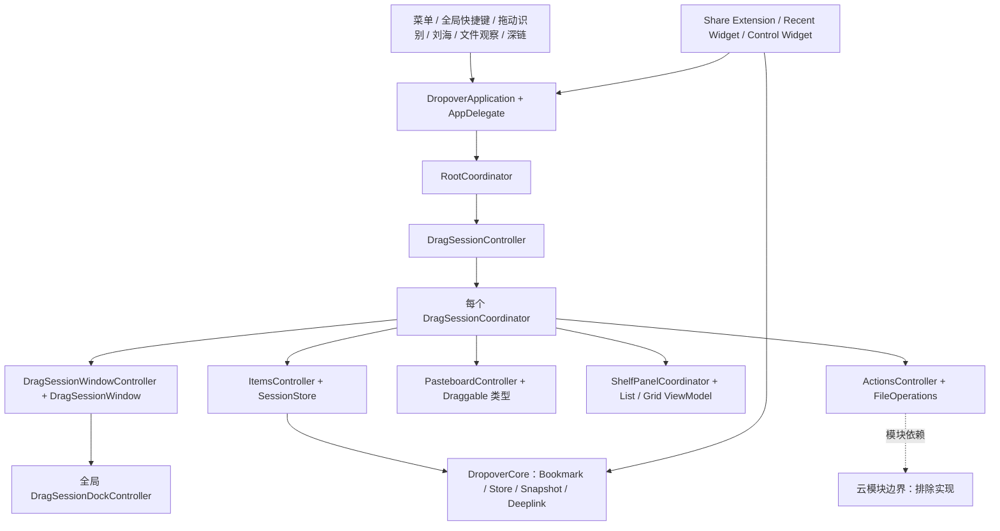
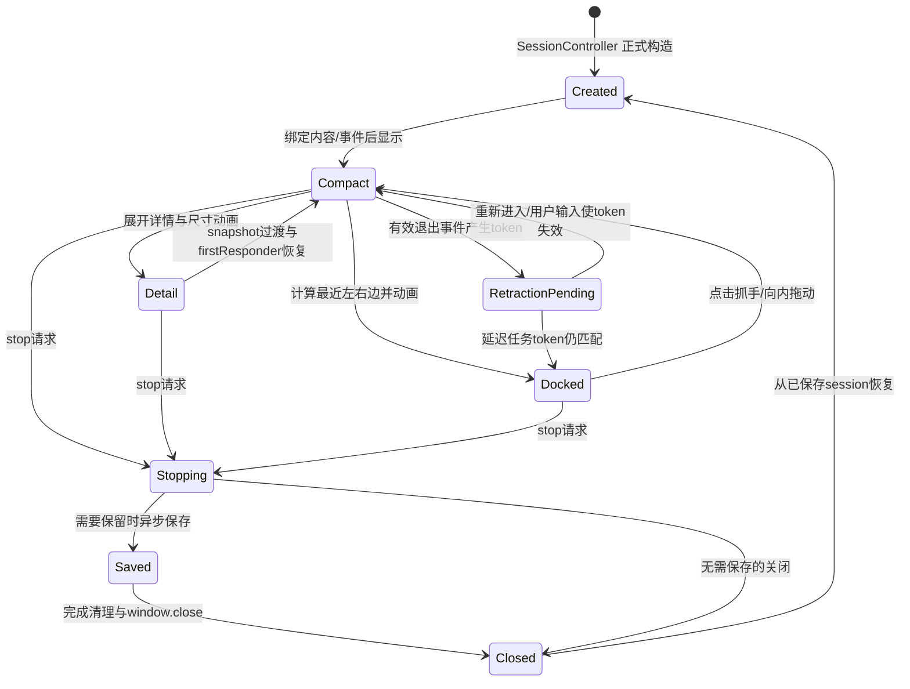

# Dropover 5.2.0：架构与窗口系统逆向报告

分析对象：本机 `/Applications/Dropover.app`，版本 **5.2.0（653）**。分析日期：2026-10-11。云上传、账号、分享链接与服务端实现排除；系统 Share Extension 收录入口和本地操作窗口属于范围内。

## 1. 结论与证据边界

Dropover 是 **Swift 为主、AppKit 掌握窗口与拖放、SwiftUI 构建部分界面、Combine 连接状态变化**的原生 macOS 应用。没有发现 Electron/Chromium/JavaScript 应用壳。这里的架构判断来自实际 Mach-O 依赖、类型与字段、Interface Builder 连线及方法体，不能仅用 UI 外观或字符串判断。

架子并非单个可拖动视图：每个 `DragSessionCoordinator` 拥有自己的窗口、内容控制器、拖放控制器、动作控制器、详情面板、设置弹窗、收缩控制器和保存节流器。全局的 `RootCoordinator`、会话控制器和 `DragSessionDockController` 再管理入口、多个架子和屏幕边界。窗口身份、内容身份与保存记录分开存在。

**必须限定为本机产物：**主程序带 adhoc 签名、缺少扩展使用的 application-groups entitlement，并加载额外 `libDropover.dylib`。该库在静态初始化中 hook 主程序 `0x100079ba0`，将结果固定为 true，并 hook `NSBundle.localizedStringForKey:value:table:`。因此签名、权限、该判断和中文文案都不能直接归因于官方发行版。没有移除、执行调试副本、重新签名或修改安装程序。详见 [包身份与 hook 证据](evidence/package/FINDINGS.md)。

证据标记：

| 标记 | 含义 |
| --- | --- |
| 静态观察 | 实际安装包字节、资源、类字段、汇编或反编译方法体 |
| 运行观察 | 正式原生应用中仅对新建测试架子和生成素材的 UI 操作结果 |
| 推断 | 由已验证结构作出的解释，未直接观察全部运行条件 |
| 未解决 | 当前工具、平台、隔离范围或分派解析不能充分回答 |

伪代码是说明性的恢复结果，**不是原始 Swift 源码**。Swift ABI 的隐藏返回寄存器、泛型元数据和闭包环境经常使反编译变量错位；关键常量、比较和系统 API 实参用 arm64 指令交叉核验。函数数量不作为完成证明，逐功能状态见 [COVERAGE.md](COVERAGE.md)。最新追踪与修正见 [逆向缺口补证](GAP-CLOSURE.md)，详细分派和完整 Evidence ID 保存在入口、合并、取消三份补证笔记。

## 2. 分析基线与可复查资料

| 对象 | 实际结果 |
| --- | --- |
| 主程序 Universal SHA-256 | `b0120976ab702cbd3eaca13e4e596bb5d4d6db8eeae776fb78e234b9d78b5294` |
| 提取 arm64 切片 SHA-256 | `b5dfa561d25dadff69ddc22376b626e32175f8fb1dac00a32fe08795707c2239` |
| 主程序架构 | arm64、x86_64；逐函数深入使用 arm64，未逐函数证明两架构一致 |
| 启动声明 | `NSPrincipalClass=DropoverApplication`、`NSMainStoryboardFile=Main`、`LSUIElement=true` |
| 最低系统 | macOS 13；控件扩展另有更高系统要求 |
| 深度引擎 | REA 6.1.0、Ghidra 12.1.4、JDK 21；仅为自有进程指定环境变量 |
| 原生运行环境 | 单显示器，AppKit 2240×1260 点，backingScaleFactor=2，visibleFrame 高 1229 点 |

REA 的 Universal 导入不能保证选定架构，故用 `lipo -thin arm64` 提取分析副本，安装包保持不变。首次主程序默认 330 秒启动期限超时，后续改为进程级 1200 秒；失效 ready 标记和错误占位 JSON 不当作分析成功。超出 MCP 帧大小的结果通过导出 Evidence ledger 恢复，原始错误与恢复结果分别保留。

资料入口：

- [包库存、资源和签名](evidence/package/FINDINGS.md)：所有模块路径、哈希、依赖、扩展身份。
- [Objective-C 字节索引](evidence/main/objc-index.json)：恢复类、selector、IMP 和 ivar；处理现代相对方法表与 chained pointer，BSS 中待运行初始化的字段偏移不误作零偏移。
- [Swift 类型索引](evidence/activation/swift-types.json)：类型描述符、字段、元数据访问器与可恢复 vtable。
- [完整函数起点](evidence/activation/function-starts.json)与[直接 BL 调用索引](evidence/activation/direct-calls.json)：36,285 个文件声明起点和 202,351 条原始直接 BL 记录；不涵盖尾跳转、ObjC 消息或 Swift 协议分派，不等于完整动态调用图。
- [Interface Builder Evidence](evidence/package/interface-builder-evidence.json)：14 份资源，909 个图节点、411 条边；全部找到的 archive 已解析，私有未知字段仍留未知。Evidence `ev_615e475c45a63562ca7f74a150d5e76d8ab6099fa97dbe7e4c04a73bc50ca829`。

## 3. 应用架构与状态归属



关键所有者由 [ObjC 字段](evidence/main/objc-index.json)与对应函数体共同确认：

| 所有者 | 关键状态与职责 |
| --- | --- |
| `RootCoordinator` | sessionController、windowCoordinator、menuItemController、目录观察协调器、六种全局架子 hotkey、preferences、Combine subscriptions |
| `WindowCoordinator` | 全局设置、介绍、更新说明、About 窗口；截图观察器及目录观察器引用；关闭时清理窗口引用 |
| `DragSessionCoordinator` | id/source、isStopping/hasStopped、label/tag、delegate、sessionStore、itemsController、window/view、actions/pasteboard/panel/retractor、settingsPopover、saveThrottler |
| `DragSessionWindow` | effectiveSize、尺寸过渡、最后交互/移动时间、mouseDown、overlayController、弱事件观察列表、键盘编号提示 |
| `DragSessionDockController` | 末次横纵拖动速度、mouseDown 的窗口/鼠标位置、每个 windowNumber 的跟踪点、screenFrames、窗口观察 token |
| `PersistentDragSessionStore` | 会话记录、专用 sessionsQueue、JSON 保存节流、缩略图快照 |
| `OutlineViewModel` | draggables、selectedIndexes、quickLookItems、displayMode、isQuickLookActive、加载与动作状态；List/Grid 共用模型 |

这种分工可解释为什么一个架子能独立改变名字、颜色、固定状态和 Spaces 策略，又能被全局快捷键统一选择或停靠。此句是基于已恢复所有者的结构解释，并非原作者声明的设计模式；不能由此认定项目严格遵循某一种 MVVM/Coordinator 框架。

线程边界包括主线程 UI、NSEvent monitor 回调、NSTimer、DispatchWorkItem、目录/文件队列、Combine 订阅和 Swift async continuation。不能把所有异步都称为后台线程：Core ItemStore 的保存 Throttler 实际使用 main queue；图片快照另明确诊断“不应在主线程生成”。

## 4. 窗口实现：属性、焦点与响应链

### 4.1 架子是无边框 NSWindow

`DragSessionWindowController.init @0x100071360` 创建 `DragSessionWindow`，后者 `init @0x100071d6c` 跳入实际初始化 `0x100071a30`。实际恢复值：

```swift
// 解释性恢复；静态虚拟地址 0x100071a30
super.init(contentRect: NSRect(x: 0, y: 0, width: 198, height: 207),
           styleMask: [], backing: .buffered, defer: false)
isMovableByWindowBackground = true
collectionBehavior = NSWindow.CollectionBehavior(rawValue: 0x25)
level = NSWindow.Level(rawValue: CGWindowLevelForKey(.floatingWindow))
backgroundColor = .clear
hasShadow = true
isOpaque = false
isReleasedWhenClosed = false
animationBehavior = .alertPanel // raw value 5；本地 AppKit SDK 核验
delegate = self
overlayController = DragSessionWindowOverlayController(window: self)
DragSessionDockController.shared.observe(window: self)
```

`198×207` 是构造初值，不是所有状态的固定尺寸；运行详情视图宽度会增至 400 点。`styleMask=0` 不是 NSPanel 类型，窗口原生标题栏/标准关闭按钮没有启用，显示的圆角、X 按钮、抓手及内容由自定义视图绘制。`initWithContentRect:styleMask:backing:defer: @0x100073370` 的通用初始化入口反而触发 unimplemented initializer，不可把它当正式建窗路径。

证据：[实际构造方法体](evidence/activation/long/root-functions/0x100071a30.json)，`ev_0c5ee8e435439a8c04755c7da52500a98bf1307d679ee5a9d1b791ef498670fe`；[controller init](evidence/main/functions/0x100071360.json)，`ev_bc0f061c57969c05500c81996f362519f0cbe7434e0e984f4d8826bbc760c0db`。

### 4.2 可以取得焦点，不表示显示就抢焦点

`canBecomeKeyWindow @0x100071d8c` 恒定返回 true。显示策略由调用者决定。实际show入口 `0x10024e1e4` 设frameOrigin后读取偏好：false走orderFront，true则在NSApp非active时activateIgnoringOtherApps，再makeKeyAndOrderFront。完整dossier已从final/session-evidence导出恢复至 [show方法](evidence/main/final/retained/0x10024e1e4.json)，`ev_c0ef5448069499e26c21e08ecaf28043684a4ebca35450ab906837f04641133f`。运行中通过“窗口 → 新的悬浮窗”创建测试架子时，当前应用仍为 Codex；AXFocused/AXMain 均为 0。点击架子后 Dropover 成为前台，详情窗口 AXFocused=1。因此“允许成为 key window”和“显示时自动激活”必须分开解释。

5.2 的官方说明同样把“出现时不取焦点”和“可恢复旧行为”分开，且说明本地架子快捷键只在激活后工作。[官方 5.2 说明](https://dropoverapp.com/whats-new/5.2.0)、[快捷键说明](https://dropoverapp.com/kb/shelf-keyboard-shortcuts)。本机偏好键及代码分支另见激活调查；没有切换用户原有全局偏好来做对比。

`windowDidBecomeKey:` 更新交互时间并进入内部通知/观察路径。mouseDown、mouseDragged 同样记录最后交互日期；mouseDown 还设 `isMouseDown=true` 并在 main queue 延后 **100ms** 执行弱引用闭包。mouseEntered/Exited 通知事件观察列表，管理 overlay tooltip：进入设 showsTooltip=true，退出设 false，若可见则 orderOut。事件观察使用弱引用，失效观察者不执行闭包。

证据：[canBecomeKeyWindow](evidence/main/functions/0x100071d8c.json)，`ev_4c37759abd38cc4c63935c76f06815f84adc814b9d4316fb2053c5ee3925f02b`；[mouseDown 实体](evidence/activation/long/root-functions/0x1000729a8.json)，`ev_d728882a4dd84de2041e8f98876054e59b86399283a14c2fef10b37206275f70`；[进入](evidence/activation/long/root-functions/0x10007306c.json)、[退出](evidence/activation/long/root-functions/0x1000731d4.json)。

### 4.3 Spaces 与 Mission Control 必须按实际位掩码解释

架子初始 `collectionBehavior=0x25` = `canJoinAllSpaces | managed | participatesInCycle`，本身没有 `fullScreenAuxiliary` 位。这个组合由本地 SDK 常量核验。它不能直接证明所有全屏或 Stage Manager 场景；后续每架子的“保留在自己的 Space”设置还可能改变位掩码，应读取修改方法体。

刘海窗口使用另一组合 `0x11` = `canJoinAllSpaces | stationary`；键盘捕获窗口在原 collectionBehavior 上 OR 1。它们不是架子窗口的统一策略。Apple 对这些位的定义见 [CollectionBehavior](https://developer.apple.com/documentation/appkit/nswindow/collectionbehavior-swift.struct)。本机只有单显示器，未实际切换 Spaces、全屏或 Stage Manager，相关运行行为保留未验证。

### 4.4 键盘选窗为什么需要额外窗口

`KeyboardDragSessionSelectionCoordinator` 拥有候选 coordinators、dimmingWindow、keyCaptureWindow、overlayWindows、hotKeys 和应用活动观察 token。启动 `0x100039e14` 明确 activateIgnoringOtherApps、orderFrontRegardless、makeKeyWindow，并把 capture content 设为 firstResponder。

实际 keyCaptureWindow 构造 `0x10003a648`：目标 screen.frame、无边框、透明背景、无阴影、alpha **0.01**、level **3**、ignoresMouseEvents=true、跨 Spaces；并注册 mask `0x0200000a` 的 global mouseDown 监听。它几乎不可见，但负责集中接收键盘。每个架子的编号由独立覆盖窗口/提示视图负责显示。

`performKeyEquivalent @0x10003bb38` 有回调就调用 `onKeyDownEvent`，**无论回调存在与否都返回 true**；keyDown 和内容视图 keyDown 共用闭包处理 helper。canBecomeKeyWindow、canBecomeMainWindow、acceptsFirstResponder 都为 true。不能把这段吞键策略泛化为日常浮动架子的策略。

证据：[选窗启动](evidence/activation/long/actual-functions/0x100039e14.json)、[capture 构造](evidence/activation/long/actual-functions/0x10003a648.json)、[原始 key-capture 指令](evidence/activation/key-capture-assembly.txt)；更完整的触发、结束和退出清理见 [激活调查](evidence/activation/FINDINGS.md)。补证实际键匹配0x10003aaa0仅识别主数字键1–9及Escape，主0/numpad数字不匹配；真实取消入口0x10003a208清observer/提示/capture/hotkeys。详见 [编号键与取消](evidence/gap-entry/FINDINGS.md)。

## 5. 所有创建与激活入口

### 5.1 摇动检测不是简单“鼠标速度大”

主程序实际类 `DragRecognizer` 保存 session threshold、起始时间/位置、最后位置/方向、累计 turnDistance、currentNumberOfTurns、完成标记和更新时间。没有把附加 hook dylib 误当手势引擎。

| 灵敏度 | requiredTurnDistance | requiredNumberOfTurns | resetSessionTimeInterval |
| --- | --- | --- | --- |
| normal | 20 点 | 4 | 0.2 秒 |
| high | 12 点 | 3 | 0.2 秒 |
| ludicrous | 5 点 | 1 | 0.2 秒 |

距离表位于 `0x100701260`，次数表位于 `0x100701278`；Root 偏好回调 `0x10026af34` 选择档位并重设 threshold。constructor `0x100241834` 默认 20/4/0.2。step `0x10024278c` 以**水平 x 的变化方向**处理累计位移；同向累计 abs(deltaX)，反转时只有达到 required distance 才记 turn，样本间隔超过 0.2 秒重置，另外还有约 1 秒的总体 session 重置条件。完成检查 `0x100242ba8` 使用 `currentNumberOfTurns > requiredNumberOfTurns`，所以表中参数不能直接翻译成“摇四下完成”。

```text
NSEvent 拖动
  → DragRecognizer dragged handler 0x100241cd0
  → 修饰键匹配则 modifier callback 0x100241f1c
  → 否则 shake path 0x100242184
  → session.step 0x10024278c
  → 距离/方向/停顿判断
  → 完成分支与回调
  → 主应用会话创建入口
```

拖动 handler 开启 **0.2s** 的 pasteboardWatchDog NSTimer，跟踪停靠窗口 windowNumber；配置的修饰键 mask 必须是 event.modifierFlags 的子集才走修饰键回调。release `0x100242410` invalidates timer、清停靠/更新标记，main.asyncAfter **0.1s** 后重置。忽略应用、系统权限与启用开关在外层管理，不能把算法成功等同全部环境都可触发。

证据：threshold 回调 `ev_22146f288942ca75fcbda07aa73ee26c5ba5a213ef6cbcbdf6b65ceeda66afce`；step `ev_40a900cffedc9feb5000f5d47134115a7805614241543744b007becd6bf0ae21`；drag handler `ev_37018aae8a165f52d58b846156db9bf576d02e5217bcbf635cb82bdb0c9c2f98`。完整函数链接、指令与保护条件见 [激活调查](evidence/activation/FINDINGS.md)。新增source resolver证实忽略名单匹配kCGWindowOwnerName（应用显示名）而非bundle ID，guard为非ignored且(pasteboardChanged或Dock)，未知owner不自动拒绝；见 [来源资格补证](evidence/gap-entry/FINDINGS.md)。

### 5.2 刘海区域是独立非激活覆盖窗口

`NotchDragObserver` 注册 global leftMouseDragged(mask 0x40) 与 leftMouseUp(mask 0x4)，停止时逐个 removeMonitor。支持判断遍历 NSScreen，查 `safeAreaInsets.top != 0`；没有刘海的屏幕不会仅凭窗口类型存在就启用。

gap 矩形由 `auxiliaryTopLeftArea` 和 `auxiliaryTopRightArea` 之间的区域计算。`NotchWindow` 构造 `0x1001786b8` 在 gap 基础上扩展 x−40、y−40、width+80、height+40；styleMask=0x8000（nonactivatingPanel 位，类仍是 NSWindow）、level=25、hidesOnDeactivate=false、canHide=false、movable=false、opaque=false、shadow=false、collectionBehavior=0x11。

距离 helper `0x100106e18` 先算点到矩形各轴的外侧距离，轴内距离为 0，双轴均非零时 hypot。控制器 highlightBehavior 与距离 **10 点**分支决定显示；退出用 isDismissing 防重复动画。高亮进入 glow 动画 **0.2s**，退出 glow/ring 动画 **0.5s**，CATransaction completion 处理后续。

证据：构造 `ev_69bc7db27c64a8d7b7c8765d96cc0e5a9bb6d984ba0238a591c116e32a5cd6ff`；距离 `ev_0b030d8f4bb9220d2cd25e6f6b75569fa0465938efba644849abf0cad8c0e43e`。本机可用屏幕不支持实际刘海交互，静态回答与运行未验证分开。

### 5.3 菜单、快捷键、文件观察、系统集成

主菜单 nib 的 `didSelectNewShelfMenuItem:`、`didSelectPreferencesMenuItem:`、`showAboutWindow:`、`didSelectQuickStartGuideMenuItem:` 均连接 AppDelegate；系统编辑动作保留 responder-chain，不能从 target=nil 推断无实现。运行创建测试架子从“窗口 → 新的悬浮窗”点击，未直接调用 IPC 或改内部状态。

Root 字段表确认 new、clipboard、recent、close-all、dock-all、select 六种全局 hotkey，各自启用与设置更新另有通知处理。剪贴板路径静态分析，未读取真实剪贴板；close-all/dock-all 没有运行，避免影响现有架子。目录观察与截图观察使用各自 observer/activator，规则、启用及互斥不由“文件夹变化即建窗”一句替代；具体代码与仍未闭合分支见激活调查。

Core 深链解析顺序：先 scheme==`dropover`，然后逐个协议 init(url:) 尝试 StaticActions、NewShelf、NewClipboardShelf、OpenDragSession、OpenLastShelf、Feedback，取首个成功结果。`dropover://shelf/new`、`new-clipboard`、`last` 除 host=shelf 还验证 pathComponents 与最后组件。主 AppDelegate `application:openURLs:` 先收 file URL；否则处理匹配 scheme 的入口，pendingActions 再交主 executor。它不是浏览器窗口或任意脚本执行入口。

Share Extension 收录：并发加载 attachment → 按 supported type 失败重试 → 在 app-group/Transient 保存本地结果 → 非空成功集合发 `ShareExtensionDidShare` DistributedNotification 并启动主应用 → 主应用消费文件并建架子。没有成功项则 completeRequest 不启动。URL 可生成 webloc，图像转 TIFF，文本生成 UTF8/RTFD，文件引用走 copy。扩展没有自己承担常驻架子窗口。详见 [扩展与深链代码](evidence/package/FINDINGS.md)。

Recent Widget 使用 Core 读取 `.drag_sessions` 与快照，构造一次 `.never` Timeline；每行通过 `OpenDragSessionDeeplinkAction(id).url` 的 SwiftUI.Link 重开，空位无 Link。Control Widget 的新/剪贴板/最近/关闭/停靠五动作通过深链或 StaticActions 交主程序。所有 Widget 行为均只作静态观察；本机主程序 app-group entitlement 差异使实际互通不能默认通过。

## 5A. 多入口如何接到正式会话

以下是补充追踪后的链路，不再停在观察器字段或 deep-link 字符串。完整实际记录已恢复至 `evidence/main/deep/retained/`；此前超出运输大小的 `149300`、`1f72d0` 已通过新导出恢复。

### 菜单栏拖入：三种收录策略

NSStatusBarButton+Dragging实际注册四类reader汇总类型，associated handler接收外部drag；non-nil draggingSource拒绝，接受时alpha0.4，退出恢复1。perform枚举可转为Draggable的对象，空false；非空Bool仍不证明窗口显示。MenuItemController→SessionController按newShelf、visibleShelf、lastActiveShelf分流；后者可验证首个未开放persistent候选，保留ID/label且saved+incoming按identity去重，失败回退新建。完整叶函数与失败分支见 [入口补证](evidence/gap-entry/FINDINGS.md)与 [补证报告§1](GAP-CLOSURE.md)。

### 全局快捷键：Carbon 注册与 key-up 回调

Root `0x100268608` 为六组组合构造 HotKey，替换旧对象前将旧对象暂停，并按每项启用状态暂停/注册新对象。六组绑定的是 **keyUpHandler**，不能描述成所有功能都在 key-down 执行：

| Root 字段 | thunk → 实际动作 |
| --- | --- |
| showHideHotKey | `0x10026de60 → 0x100269f14` |
| showHideClipboardHotKey | `0x10026de58 → 0x100269fb8` |
| openRecentWindowHotKey | `0x10026de50 → 0x10026a114` |
| closeAllShelvesHotKey | `0x10026de48 → 0x10026a17c` |
| toggleDockShelvesHotKey | `0x10026a1e8 → DockController 0x100008024` |
| selectShelfHotKey | `0x10026de40 → 0x10026a300` |

`0x1006572e0` 调 Carbon `RegisterEventHotKey(keycode, carbonModifiers, EventHotKeyID, GetEventDispatcherTarget(), options:0, &ref)`，检查 OSStatus==noErr **及 ref 非 nil** 后才保存 carbonEventHotKey、按需安装全局事件 handler。失败路径在该方法只返回，不能杜撰“自动弹出冲突警告”。暂停 setter `0x100655dcc` 走 Unregister/map remove，恢复则注册。实际 `0x100657778` 检查 EventHotKeyID.signature 与对象映射，isPaused=false 才按 event kind5/keyDown、kind6/keyUp调用对应闭包；不匹配或无 handler 返回事件未处理状态。

证据：六组 Root 绑定 `ev_058a78fbf761ecd1cdd3ed99796da389968046b7d00f91a9845d9901724dba73`；[Carbon 事件分派](evidence/main/deep/activation-closure/0x100657778.json)，`ev_dddf41ecf4b5e7d04919a9088fd7b5b11c81bf4af5184c60e72b3d95623ca8b2`。设置组合验证已追到实际规则：非默认global要求有效modifier且非Shift-only，shelf/default有例外；系统CopySymbolicHotKeys比code/modifiers、未筛Enabled；本app17动作精确组合冲突剔除自身。tag0/1/2/3为无效/内部/系统/合格，录制错误显示NSAlert sheet，启用错误保持关闭。完整规则及Ghidra边界修正见 [快捷键补证](evidence/gap-entry/FINDINGS.md)。这与Carbon注册返回码是不同阶段，运行设置未验。

### 截图观察：目录事件、定位、分发到架子

`SessionController 0x1001f4004` 把 ScreenshotObserver.changeHandler 接到 `0x1001f7c74 → 0x1001f42cc`，按偏好启动/停止。目录 FD、DispatchSource.write、0.5s Throttler 已在激活调查恢复；节流回调 `0x1000def34 → 0x1000de99c` 进入 locator，定位任务 `0x1002a76d4 → 0x1002aab00 → 0x1002a7fc0` 搜索并对尚未满足条件的结果安排重试。最终 `0x1000dead4` 只在 URL 有值且 changeHandler 存在时派发，nil 不伪造成文件。

正式消费 `0x1001f42cc` 判断截图分发偏好；查找 tag99、适用状态的已有架子以追加，或用 `0x1001f248c` 建新架子并赋 tag99。可选的 copy-to-clipboard 分支会清空/写入系统 pasteboard，confirmation 分支构造 MessageWindowController；本轮仅静态追踪，这两个有副作用选项没有执行。外层 watcher 的成功不等于任意目录文件都被当截图，定位器还有 metadata/文件就绪判断与 nil 结果。

证据：[截图派发](evidence/main/deep/retained/0x1001f42cc.json)，`ev_55f187811652cd28cad2d9eb96f84bea3b978864f7182a968177a4a635568f0f`；[Observer completion](evidence/main/deep/activation-closure/0x1000dead4.json)，`ev_262c1fe92ed51c4fad21dc9fa47fb9ede7b0764dfbbc926785173ca2224e7cc0`。

### 监听文件夹：初始基线、差分与规则

Root `0x10026a434` 配置监听目录；`DirectoryObserverCoordinator 0x1001a97e4` 设置 onChange 并启动 observer，回调实体 `0x1001a9bf4` 构造 DraggableFile、安全作用域 bookmark，按 appendsToExistingShelf/关联会话状态选择追加或正式新建。不是在 UI 中直接写素材记录。

底层 `FileSystemChangeObserver.performDiffOperation @0x1000cf8d4` 用 NSFileManager.contentsOfDirectoryAtPath，维护 lastItemNames、lastItemSystemFileNumbers 和 quarantinedItemSystemFileNumbers。**第一次扫描只建立基线**，不会把原目录中所有文件立即当新文件。后续以当前名称与文件号识别差分，应用 onChangeFileLimit 后才调用 onAdded；目录失效有 onRemoved 分支。默认节流0.4s、50项上限，递归子目录观察另维护增加/移除的 observer；这些限制不能解释成永远支持任意规模或任意树深。

证据：[目录 diff](evidence/main/deep/retained/0x1000cf8d4.json)，`ev_5ef2629f3e12cefbbe9cb2fd72669bbcfbd4b815cc0082a67619c1e90bc75673`；[目录结果 → 架子](evidence/main/deep/retained/0x1001a9bf4.json)，`ev_1a80f383302281ca776800e6a13ee52908e8532d37d072e56d5bf408561ddefc`。所有筛选规则组合的具体外部目录运行矩阵未执行，保留在覆盖表。

### 刘海拖入与悬停

entered 触觉反馈后选择 source operation：允许 move则0x10，否则copy1。updated `0x10019026c` 用 **Manhattan 距离 abs(dx)+abs(dy)≤8点**判断悬停稳定，经过 **0.9s**且未触发 hold才进入 `0x1001905e0`。这与摇动的水平转向和 ActionDock 的 Euclidean12点是三种不同算法。

hold 将 hasTriggeredHold=true，再把 location 转 screen坐标，调用 interactionHandler（没有数据的 hold 请求）；performDrop `0x100190b20` 实际通过 reader registry/AppKit 枚举获取 draggables，仅在 screen存在且对象非空时回调。SessionController 的 `0x1001f4178` 将位置、屏幕、对象接到 `0x1001f248c` 正式会话入口。`hasTriggeredHold` 与 `isDismissing` 分别保护悬停重复触发和退出动画重复。

证据：[hold](evidence/main/deep/activation-closure/0x1001905e0.json)，`ev_e350baf56bb41b8194bbb20b159d58e44e4bfca623c3e542a0e3d7bb19ff8b56`；[SessionController 接线](evidence/main/deep/activation-closure/0x1001f4178.json)，`ev_6533d5141a384c737afc72ca5998da7d2440d3d9f307a524628a5bae79e81d52`。

## 6. 窗口与辅助视图清单

| 类型 | 功能和已经恢复的机制 | 证据层级 |
| --- | --- | --- |
| `DragSessionWindow` / Controller | 无边框架子，key focus、鼠标事件、尺寸和交互时间、overlay、停靠注册 | 方法体＋运行 |
| `ShelfPanelCoordinator` | 在同一架子窗口里展开详情，保存 originalWindowFrame/initialContentSize，List/Grid 共用 ViewModel，外侧事件监听 | 方法体＋运行 |
| `DragSessionWindowOverlayController` | 停靠箭头/抓手、tooltip、showsOverlay/showsTooltip/isHideAnimationInProgress；避免重入动画 | 方法体 |
| `DragSessionOverlayTooltipWindow` | title、arrowPointingDirection，独立 tooltip 窗口 | 方法体＋出现元数据 |
| `KeyboardDragSessionSelectionKeyCaptureWindow` | 透明集中捕获键盘，不拦鼠标；全局 mouseDown 退出入口 | 方法体 |
| `KeyboardDragSessionOverlayWindow` / HintOverlayView | 对应 targetWindow 的编号显示；Hint 的 acceptsFirstMouse=true，onSelect 点击闭包 | 方法体 |
| `NotchWindow` | 刘海 gap 的常驻/临时非激活覆盖，ring/glow，独立拖动目的视图 | 方法体 |
| `ActionDockWindow` | 架子下方 Instant Actions 的独立宿主窗口 | 类型/方法体，运行未执行动作 |
| `SettingsWindow` | 全局设置，performKeyEquivalent 有专门 helper；内容含 AppKit/SwiftUI 设置页 | 类型/方法体，未改变用户设置 |
| `PageWindow` / Controller | 介绍页容器，pages、delegate、containerViewController；windowDidLoad/keyDown | 类型/资源/方法体 |
| `WhatsNewWindow` / Controller | 更新说明，独立 keyDown；由 WindowCoordinator 缓存引用 | 类型/方法体 |
| `AboutWindow` | About 面板，由 WindowCoordinator 管理 | 类型/方法体 |
| `MessageWindow` / Controller | 错误/提示；保存 message、dragSessionWindow、onDismiss、dismissTimer，timeout 与 mouseUp 关闭入口 | 类型/方法体 |
| `QLPreviewPanel` | 系统 Quick Look，独立 level 9 窗口，DataSource/Delegate 生命周期 | 方法体＋运行 |
| `NSPopover` | 每架子设置、文本或可滚动文本详情；独立 popover controller 与 didClose | 资源/方法体＋运行 |
| `DropoverFileOperations.ImageRedactWindow` | 独立图像标注/遮挡窗口，ImageRedactCoordinator管理window/image/exporter，Toolbar管理export选项；见下文原始指令边界 | framework元数据＋汇编，未运行 |
| `NSOpenPanel` / `NSSavePanel` | 文件/目录选择或本地操作参数；当前方法与输入校验另追踪 | 模块/方法体，运行未确认全部对话框 |

完整类、selector 与字段见 [objc-index](evidence/main/objc-index.json)。nib 全部被解码并不表示程序化生成的 SwiftUI 或 AppKit 所有布局均由 nib 定义；运行的架子/详情主体属于程序动态创建路径。

FileOperations另有 `ImageRedactWindow`（framework arm64 SHA `d73ae408709a6b954524722df5f95ee40607dc352445e4c4c582478ff225973f`）。其一般ObjC构造 `0xc79b4` 为unimplemented initializer陷阱，正式窗口构造在Swift专用路径，不能用这个陷阱宣称功能不可用。Coordinator的指令可见setContentViewController、releasedWhenClosed、setDelegate、alpha/NSAnimationContext、makeKeyAndOrderFront、按image.size与screen.visibleFrame设frame和contentSize；导出流程给NSOpenPanel设置只能选目录、可建目录、message/prompt、runModal，取消会重置状态。释放/退出路径清delegate、windowController、contentViewController、contentView并performClose。Toolbar的createCopy/overwriteFile与revealInFinder/showInShelf是独立选项；没有执行覆盖原件。证据：[framework类索引](evidence/content/fileops-objc.json)、[Swift字段](evidence/content/swift-types.json)、[原始窗口/对话框汇编](evidence/content/redact-window-assembly.txt)。此补充是file-backed汇编观察，没有杜撰REA Evidence ID；图像标注工具各mode内部算法及完整导出/取消结果仍不称运行已验收。

## 6A. 停靠、详情、自动收缩和关闭的实际状态链



这是根据状态字段和方法体整理的解释图，不声称原代码存在单个同名 enum。动画与异步接收各有独立状态，图中的 Compact/Detail/Docked 不是替换 `isStopping`、`isAsyncDragInProgress` 的统一状态机。

### 停靠几何与动画完成

全局 DockController 由 `0x100005364` lazy singleton创建，注册每个 windowNumber 的弱观察 token。屏幕变化 handler `0x100006194 → 0x1000059b8` 重新采集 NSScreen.frames，只对 DragSessionWindow 候选处理，在屏幕布局实际变化时重新整理停靠窗体。多屏外界改变不要求每个架子自己各注册一套屏幕管理器。

目的 frame `0x10000731c` 使用 screen.frame，保持原 y/尺寸：

```text
leftDock.x  = screen.minX - window.width * 0.84
rightDock.x = screen.maxX - window.width * 0.16
leftUndock.x  = screen.minX + 12
rightUndock.x = screen.maxX - window.width - 12
```

停靠保留约16%宽度在屏幕内。与运行198点宽→右侧露约32点吻合。`0x100007cd8` 根据绝对 drag velocity选时长（1–1.5约0.6s，1.5–2约0.45s，2–3约0.35s，其他约0.3s），交 `0x100007410`：NSAnimationContext、easeOut、allowsImplicitAnimation、window.animator.setFrame(display:true,animate:true)。completion `0x10000750c` 才建立 overlay、更新箭头方向/抓手opacity及屏幕相关后续状态。

展开 `0x1000078b0` 是另一 frame 与 animation closure；不是简单把 alpha改成1。拖动事件处理 `0x100006250` 先排除正在拖出内容的架子及 panel存在的状态，区分 mouseDown、dragged、mouseUp、clickCount、初始点、末次速度，必要时重设跟踪点与 tooltip。由于这个函数的 Swift CGRect返回寄存器恢复错位，报告不把其所有中间变量名当原始几何语义。

证据：[dock目的frame](evidence/main/deep/retained/0x10000731c.json)，`ev_3285d1717a3f29dc2b1b81a1e4250f787761b6ba755500978342f8bd935cc18c`；[dock动画](evidence/main/deep/retained/0x100007cd8.json)，`ev_8dbc865cae0660a792fa2b662a2e7d99128cc0fd08698e16802972eed8f4c9a7`；[系统动画leaf](evidence/main/deep/retained/0x100007410.json)、[completion](evidence/main/deep/retained/0x10000750c.json)；[展开](evidence/main/deep/retained/0x1000078b0.json)。

### 自动收缩有撤销资格，延迟不是盲执行

Coordinator.retract `0x1002568c4` 创建独立 `DragSessionWindowRetractor`，赋 onCancel弱闭包并 start。start `0x1001d7de0` 仅在弱window仍存在时设 started=true、保存事件观察 token。事件handler `0x1001d80dc` 处理进入/退出/输入，符合退出条件且当前无计划时生成新 UUID写 scheduledRetractionToken，交 `0x1001d8700` 在 main queue **1秒**后执行；重新进入则清token，适用用户事件调用stop与onCancel。

延迟 closure `0x1001d8b7c` 先 weakLoad retractor，再检查捕获 UUID 与当前 scheduledRetractionToken相等。不同则返回，**不用取消底层已排队闭包也能让旧任务失效**。相同才走窗口收缩helper `0x10016c814`、stop事件监听、清token。stop `0x1001d7a58` 通过保存的观察token注销，并清事件token/计划token；deinit再次调用stop。它不是一个永久不断查询鼠标的计时器。

证据：[start](evidence/main/deep/retained/0x1001d7de0.json)，`ev_cbe15720c702168c6728da87359e7f416c1d36bdcdcc36765cd8daf63d34e255`；[事件分支](evidence/main/deep/retained/0x1001d80dc.json)，`ev_5df1403d163eb989b4b59b6a3ac18655e577b304d610ad2eaf083237cfc9d84b`；[1秒调度](evidence/main/deep/retained/0x1001d8700.json)，`ev_d25f1a0f9b97bc01ededd3ddc3d96ce790458d8155094e43dd90abde5624b4e5`；[UUID资格](evidence/main/deep/retained/0x1001d8b7c.json)，`ev_2a478e6f608d6ac3709b1a51c12d5751917df028751525f0f572fda33a8c19fc`。

### 详情展开/收回：换内容、调尺寸、交接响应者

展开 `DragSessionCoordinator 0x10024db54` 创建共用 OutlineViewModel、ShelfPanelCoordinator及目标视图；构造 `0x1000ad280` 保存window弱引用、preferences、container回调。详情动画保存 originalWindowFrame/initialContentSize，使用 snapshot image遮盖过渡，设置 effectiveSize 与 isSizeTransitionInProgress，NSAnimationContext调整窗口frame。

完成 `0x1000ae1d4` 隐藏原 dragSessionView、把panel设为正式内容，becomeKeyWindow、makeFirstResponder(panel)，只在不存在monitor时安装mask `0x4000014` 的 global事件监听。全局点击handler按鼠标是否在架子内决定后续close detail，偏好 `automaticallyCloseShelfDetailView` 仍控制行为。

收回 `0x1000ad828` 生成详情截图参与动画，completion `0x1000ae53c` 移除临时snapshot和panel、清viewModel.panelCoordinator弱引用、重启dragSessionView.interactionEnabled、把firstResponder交回原view，并清Coordinator.panelCoordinator/activeOutlineViewModel。没有创建第二个“详情架子”替代原窗口；运行window_id始终21125。

证据：[构造](evidence/main/deep/retained/0x1000ad280.json)、[收回动画](evidence/main/deep/closure/0x1000ad828.json)、[展开完成](evidence/main/deep/closure/0x1000ae1d4.json)，`ev_3ace541a2623db49a89d8819d5d5b2570d8d0bca2c29d7fd900ab9a9855fd7f6`；[收回完成](evidence/main/deep/closure/0x1000ae53c.json)，`ev_ee26a1bd2755534f64475f9541094a2202810715857213fc2d06747e7bd96d29`。

### own Space、overlay与固定的区别

正式建窗 `0x100261860` 读取 PreferenceKey45 `automaticWindowSnappingEnabled`，以及47 `keepShelfInSpace`。keepInSpace=false保留canJoinAllSpaces，true清该位；其他位保持。每架子label变化handler `0x10024ec08` 根据 label自身的值更新同一位，同时刷新颜色/固定图标/动作列表。固定状态属于label/persistent record，不是把窗口level升到无限高。

停靠overlay显示 `0x1002172e0` 把 overlayView四边AutoLayout锚定到contentView、禁用原dragSessionView交互，临时清 **managed位4**；隐藏动画 `0x100217adc` 时长0.3s，alpha到0并把managed位加回。因而 Mission Control策略会随停靠显示改变，不能只引用初始0x25就宣布所有状态都一样。

所有对 setCollectionBehavior selector的静态引用已定位，见 [xrefs](evidence/main/deep/xrefs-collectionBehavior.json)，`ev_3606f4cec562069f3c3aa3a7dd8fde854630ad034c7b593d31be8b54dd677eef`。已检查的自有窗口setter没有设置fullScreenAuxiliary位；这是一项有边界的静态观察，不证明系统或未来版本的全屏行为。

### 关闭先安排状态与保存，再释放UI

stop入口 `0x10024d11c` 先设 isStopping=true；需要保存路径把window alpha置0，交 `0x100254ac8`。保存主体取Draggable URL/数据，生成security-scoped bookmarks；无法直接提供URL的项目可生成UUID `.dat`路径物化，再构造PersistentDragSession(id/date/bookmarks/label/order)交sessionStore。没有可保存内容仍通过main queue完成回调，不假造有效持久化记录。

完成 `0x100254938` 隐藏ActionDock、禁用keyboardEventHandler、设hasStopped=true、清ItemsController（取消每个文件monitor）、通知delegate移除会话、停止ActionsController、调用window.close，最后completion。**window.close不等于删除原文件**，原件动作由具体FileOperations或目的应用拥有。

拖出结束 `0x100260b00` 在持续保留分支安排saveThrottler与适用收缩；关闭分支检查 PreferenceKey46 `alwaysCloseShelf` 和最终operation传入标志，选保存或stop路径，清retractOnItemDrop并更新使用统计。相邻 UI的取消/失败不会由成功分支替代。

证据：[stop](evidence/main/deep/retained/0x10024d11c.json)，`ev_986883088ab3904bf638876b489baecb3b99f16035ebe17d2dff097a773286b3`；[关闭完成](evidence/main/deep/closure/0x100254938.json)，`ev_e4a1a7df71c8e57034626ad31c74da4fb4846a013a85452f1ae18b5dca366306`；[操作结束分支](evidence/main/deep/retained/0x100260b00.json)，`ev_582ba842cb5c64c9eebdacc455d622c0cb64ebc79845ad496d48f53142dd2e69`。

### 全局设置与消息窗口的独立清理

Settings `0x100074e10` 主动activate应用；无已有实例时创建contentViewController和SettingsWindow，styleMask0x8003、隐藏title、透明titlebar、无separator、设置delegate。若有attachedSheet，不切换当前pane/重定位；否则中心或按sender定位。collectionBehavior OR2(moveToActiveSpace)，makeKeyAndOrderFront/orderFrontRegardless/makeMainWindow。这与不抢焦点的架子路径不同。

Message dismiss `0x10011b878` 先 invalidate并清dismissTimer。无可用parent时直接close、setWindow(nil)、onDismiss；有parent时按parent windowNumber相对排序和几何动画后完成。InstantAction错误 `0x10006757c → 0x100068288` 使用localizedDescription创建 **MessageWindowController**，并非一律NSAlert；存在nil window保护路径。原生Open/SavePanel、设置中的脚本编辑页和介绍页保持各自对象生命周期，资源连线与通用window类型已纳入清单，未把未运行的所有面板按钮当已验收。

证据：[Settings真实入口](evidence/main/deep/spaces/0x100074e10.json)，`ev_1fbbb01005a598296290cf821bdb43537faae90d0fbfc4ed2d85ef116d7e943c`；[Message dismiss](evidence/main/deep/auxiliary-leaf/0x10011b878.json)，`ev_211a2c65cfe18a1060638d118200099db7380f6a867780deda4f9054a33a0598`；[即时操作错误呈现](evidence/main/deep/content-closure/0x100068288.json)，`ev_3d256a46aee70a1a6dbb25a2bd81f24e8adcac49eab45d28c0df0de5f84b618e`。

## 6B. 外观与布局：版本分支、玻璃、图像与响应区域

窗口透明只负责让内容决定形状，真正背景由ShelfBackdropView及容器实现。`0x10029b5f4` 创建统一contentView，保存customCornerRadius/legacyBackdropBlendingMode，然后以 `isOSVersionAtLeast(26,0,0)` 选择两个实现：

- macOS26+ `0x10029b6fc` 创建 **NSGlassEffectView**，cornerRadius未指定则 **24点**，四边AutoLayout与容器对齐，再setContentView。玻璃渲染是系统AppKit，不是以SwiftUI/CSS自行模仿。
- 旧系统 `0x10029b9e8` 创建 **NSVisualEffectView**、wantsLayer=true，用圆角maskImage、state=1和调用者传入blendingMode，背景与content各自四边约束。

`ShelfContentContainerView 0x1000ebf64` wantsLayer，dragSessionView放入backdrop.contentView，backdrop及原view都锚定容器四边；macOS26+容器layer另设cornerRadius24。详情panel切换时沿用这一容器，不重写AppKit窗口外壳。

DraggableItemView `0x1002cb280` layer不裁切边界，imageView unregisterDraggedTypes避免图像子视图抢目的拖放，image与容器宽高/四边约束，独立progressIndicator居中、初始alpha0。批量commit生成imageView时设置shouldRasterize、allowsEdgeAntialiasing、edgeAntialiasingMask0xf、imageScaling3，并配置acceptsFirstMouse。进度的显示属于ViewModel/Combine更新，不能由初始progress对象存在推断收到promise成功。

静态证据：[背景版本分派](evidence/main/final/render/0x10029b5f4.json)，`ev_a5a4621c4fc4ea3ed8c658b1b5f8a2b449d17fecda408bcb55250ca2ba1c574b`；[NSGlassEffectView构造](evidence/main/final/render/0x10029b6fc.json)，`ev_ac6cefdb1dbed9765030352683b4bafb6034dba80c56b66f01eb264d27666799`；[旧系统背景](evidence/main/final/render/0x10029b9e8.json)，`ev_3743f5a859e2fe8ae3b51f09bddc9be26c8836808e98d0b9a489421c4b13cacd`；[内容容器](evidence/main/final/render/0x1000ebf64.json)、[项目视图](evidence/main/final/render/0x1002cb280.json)。

### 创建位置与重叠避免

SessionController `0x1001f6f80` 按来源/传入位置选择placement策略；默认偏好fallback字符串为topRight。`0x10012fb8c` 实际识别topRight、topLeft、bottomRight、bottomLeft、center；near-cursor路径用NSEvent.mouseLocation，空screen则尝试NSScreen.main。随后进入geometry helper，不直接把cursor像素当frame origin。

`0x10012eee0` 使用screen.visibleFrame与中心/鼠标点，枚举NSApp.windows，过滤DragSessionWindow和MessageWindow，取现有frames用于空间分配；`0x10012f794` 同样收集候选障碍frame再尝试可用位置。它们处理AppKit点和screen坐标，与截图像素/CG窗口列表的左上坐标需换算，不能简单乘Retina倍数就设NSWindow.frame。实际测试使用2240×1260点、2倍backing，而PNG截图含窗口阴影padding，报告不以截图宽度反推窗口frame。

证据：[来源分派](evidence/main/final/render/0x1001f6f80.json)，`ev_cfc56c9c2e30efd008e5cf550ee10ac01f3e531322d35e9be415142115fc7ce1`；[默认位置枚举](evidence/main/final/render/0x10012fb8c.json)，`ev_a62d43e97f33e39142f18c1db1ab8b2cf904215e9596bf376f9ed5cb7d157067`；[近鼠标几何](evidence/main/final/render/0x10012eee0.json)、[现有窗口避让](evidence/main/final/render/0x10012f794.json)。多个障碍窗体、超小屏幕、负坐标多屏的完整数值矩阵未运行；浮点寄存器错误的伪代码不被抄成确定公式。

## 7. 深入内容、拖放与本地操作

详细调用链、完整 Evidence ID 和失败条件见 [内容调查](evidence/content/FINDINGS.md)。以下提炼跨窗口行为，并保留不能由成功拖入推断的边界。

### 7.1 拖入由独立 InboundDropView 处理

`DragSessionView.draggingEntered` 不是正式目的处理器；真正路径是 `DragSessionInboundDropView`，其 entered/prepare/perform/conclude 分阶段检查 canDragHandler 和 validationHandler，维护 transientDraggables、rejectedItems、isDragInProgress 与 isAsyncDragInProgress。

普通 entered 逐项 enumerateDraggingItems，解析并摆放 100×100 stack frame，写回 numberOfValidItemsForDrop；prepare 不允许零 validItems，validation tag3 才放行，失败发错误 event/隐藏 ring。普通收缩态validator按existing.cacheKey精确字符串匹配，任一incoming重复即拒绝整个drop；本层不是逐项自动去重，也不检查incoming内部重复，见 [重复规则与消息leaf](evidence/gap-merge/FINDINGS.md)。perform 禁用系统 destination animation；conclude 再收集视图/对象、合并 promise 信息，以 pasteboard 和 draggingSequenceNumber 发实际事件。**perform 返回 true 只表示接受这次拖放，不证明所有异步文件已到齐。**

30 项及以上进入效率模式：轻量 formation，conclude 设两个 in-progress 标记，把工作投给 efficiencyModeQueue 的 **500ms** 延迟任务。draggingEnded 在异步接收尚未结束时不会提前抹掉 transient 状态。该 worker 的全部失败清理还有明确缺口，不能宣称大量 promise 接收已运行验收。

### 7.2 拖出门槛与 copy/move 是两层策略

实际 mouseDragged helper `0x1000521c0` 根据起点和当前位置的 Euclidean distance，达到 **3 点**门槛后开始 NSDraggingSession。保存 outgoingItems、更新 background state，dragging leader=0。sourceOperationMask `0x1000532c0` 不使用 draggingContext：

```text
copiesContentOnDrag=true  → 0x21 = copy | delete
copiesContentOnDrag=false → 0x31 = copy | move | delete
```

这只是允许的 source operation mask；真正结果还由目的应用与修饰键决定，不是 Dropover 在 beginDrag 就复制/移动磁盘文件。结束 helper `0x100058940` 按最终 operation 分支，再交 `DragSessionCoordinator @0x100260b00` 决定收缩/关闭/保持。delete 分支中的 URL materialization collector **不是磁盘删除方法**，不能把它误写成 trash/removeItem。

### 7.3 文件承诺与内存内容落盘

Draggable 模型承担 NSPasteboardWriting/文件承诺桥接。未收到的 promise `pasteboardPropertyListForType` 返回 nil；收到 URL 后可返回 URL dataRepresentation。receivedURL 扩展名为 webloc 时额外支持 NSPasteboardTypeString，解析 plist 的 URL 字段，并非所有 promise 都自动提供字符串。

raw 图像路径读取文件名属性并取 lastPathComponent/percentDecode，无名用 `Screenshot.png`；尝试图像 pasteboard type，NSImage 验证后写 Data。有无数据/invalidImage 分支。DraggableText 持有 data/type/url/systemFileNumber/isWrittenToUrl/cacheKey；在需要文件 URL 时才通过 global queue 写入，已写入则复用，结果回 main queue。内存文本收录不等于立即复制成文件。

### 7.4 详情与 Quick Look

List 用 AppKit table，Grid 用 collection/indexPath；二者共用 OutlineViewModel 与 draggables，pasteboard writer 直接给模型对象。Quick Look 开始时设 DataSource/Delegate、isQuickLookActive；每个 previewItem 由 quickLookItems 的 URL bridge成 NSURL；该来源 provider 的 sourceFrameOnScreen 返回 CGRect.zero，没有提供精确来源动画框。

独立 QuickLookAction 的 endPreviewPanelControl 与 windowWillClose 都调用 actionCompletion 后置 nil，end 还清 previewPanel 引用，防止重复完成回调。运行测试实际出现系统 Quick Look，标题和内容对应生成的 240×160 蓝色 PNG，没有用浏览器预览代替原生窗口。

### 7.5 本地动作与取消不能冒称事务

FileOperations 的 OperationsController → OperationExecutor → 配置/逐项或序列协议实现。FileOperationState 包含 error、loading、configuration、finished。MoveOperation 的 Method 是 move/copy，Destination 是 bookmark folder/pick。

实际 Move/Copy 深链：`0x1035f4 → 0x102e04 → 0x105e74 → 0x1041f4`。先恢复 destination bookmark、安全作用域和 writable 检查；逐输入 compactMap，构造不冲突名字，method byte1 调 NSFileManager.copyItemAtURL，否则 moveItemAtURL。失败项返回 nil 后继续，**可能部分成功**。完成后停止作用域访问，main queue 处理输出：全部失败给 error；成功列表则可在 Finder 显示。没有看见已成功项的事务回滚。

cancel `0xf9340` 先 reset display，对 runningOperation 派发协议 witness +0x78，再清 runningOperation/input/descriptors/thumbnail 并刷新。追加conformance/witness证据已绑定Move/Copy及ApplicationScript的cancel到单条RET；ImageCompress再分派到JPG标记、HEIC标记及PNG的NSTask.terminate。JPG仅入口检查flag，HEIC编码体未检查flag，PNG等待退出后判断取消。UI取消不能保证同步操作终止/回滚。worker入口已取消分支绕group_leave，notify已取消分支绕清理；原始汇编中的这些静态风险尚未运行复现。Controller晚completion仅weak保护，无currentExecutor identity比对，并无条件清当时executor引用；跨操作污染可达性未证实。详见 [取消、晚回调、产物归属](evidence/gap-cancel/FINDINGS.md)与 [解释性worker伪代码](GAP-CLOSURE.md)。

## 7A. 异步完成、失效项目与 Instant Actions 的最后边界

### Promise 完成只通知实际等待者

`0x10012226c` weakLoad Promise，调用 dropoverPromise闭包并取optional URL：成功置ReceivingState.received，nil置error，然后投main queue `0x100126928 → 0x10012308c`。后者复制onReceives列表，逐个调用，最后置空；重新入队者由新的ReceivingState决定直接返回URL还是错误，nil不会作为成功文件。

ItemsController `0x1002beec0` 只有received才接续物化；失败从processing collection移除该Promise。处理queue回调 `0x1002c0fb4` 的Result失败记录错误，URL成功则读取systemFileNumber、生成options0x800 bookmark并更新cache，再装file observer、提交集合。没有fileNumber不强造持久身份。删除/清空路径取消observer与DispatchSource，不删除原件。

`0x1002bf6dc` 在文件事件后重新恢复bookmark并检查 isInTrash、systemFileNumber、是否stale、恢复后的URL是否改变；不可恢复/无效/已入废纸篓会安排pendingDelete，正常移动/重命名可更新bookmark与URL并发change通知。pendingDelete队列是ThreadSafe集合＋Throttler批量send后清空。运行中移除本次生成文本后stack自动只剩PNG，与失效文件观察一致；不把这次测试外推为跨卷、权限撤销、外部应用所有情况都已通过。

证据：[Promise drain](evidence/main/deep/content-closure/0x10012308c.json)，`ev_c25bfca52e9e615e94733f446d29b1730e5fdb01c0783a179de129b7f81fd553`；[bookmark事件重载](evidence/main/deep/retained/0x1002bf6dc.json)，`ev_5c77266d5c966a12ed59d6d6c95ed2800dc6419e46dec3501cadd4d0fb3e37f8`；[删除/清空/队列补充](evidence/content/FINDINGS-FOLLOWUP.md)。

批量模式 worker `0x10024829c` 已继续恢复到真正的文件URL/Draggable构造、ItemsController处理和main queue提交，不再只看到500ms scheduler；其main completion `0x10024be10 → 0x1002492f8` 与大批量来源组合仍独立记录。AppKit请求协议对象、promise完成、ItemsController处理各自异步，不能用一个perform Bool概括三层成功。

main completion `0x1002492f8` weakLoad目的view后，为成功的draggables构造ItemView/ViewModel并发eventHandler；其后明确设 `isAsyncDragInProgress=false`、调用 `0x10024bbb8` 清拖动临时状态。`ItemsController.add @0x1002bdcb8` 先追加items并更新changeCount，再把需物化/Promise项加入processing集合，接成功/失败回调；**这个add方法自身不是通用去重算法**，不能把去重都归因于cachedFileSystemNumbers。重复被拒还需上层validation/identifier规则，而运行中相同PNG没有重复是有限来源的结果。证据：[批量主线程提交](evidence/main/final/closures/0x1002492f8.json)，`ev_4d10f0ccda72653659a41198935a0e09ae724e6e55d9854963d71b05c7425275`；[items追加](evidence/main/final/functions/0x1002bdcb8.json)，`ev_ce2445d65a1769693ee5d2b4468eb3291c5b1714d5bcdaf3be2fafcd823c0058`。

### Instant Actions：两块内容视图与一次选择

独立 ActionDockWindow 下有 activation与drop两个视图。Container `0x1001c86a4` 接 activation.entered、drop.highlight、drop.cancel、drop.select 四个弱回调。初始drop隐藏；hover进入 `0x1002052b4` 给main queue排 **0.1s** WorkItem，位置距离anchor **>12点**重排，退出cancel工作并清nil。到期 `0x100205bb4` 回调展开；activation本身返回operation0，不消费drop。

展开 `0x1001c8a68` 设置layoutLocked/showsDropView，隐藏activation、显示drop，条高度46点。返回 `0x1001c8df8` 恢复46×46入口。Coordinator `0x1002af1ac` 用isActive防重复激活，配置frame、orderFrontRegardless和动画；隐藏 `0x1002af6d8` 清isActive/hasSelectedAction/isDragInProgress/showsDropView并orderOut。

Highlight `0x10010f1dc` 校验item index，更新selected/accent色；只有action identifier改变才onActionHighlight和haptic。perform `0x10010f77c → 0x10010fa1c` 获取实际draggables、hit-test位置，发送包含action与对象的onActionSelect，Container将hasSelectedAction=true。ObjC thunk固定true并不能绕开后续canPerform。

退出清选中/color/highlightedAction、onDragCancel，只撤回动作条。普通动作还要求items、必要configuration、canPerform；本地动作 `0x100066370` 必须先通过 OperationsController.canPerformOperationType，脚本/UserOperation另检查status与资格，不合格走错误提示。既有安全机制执行用户已配置脚本的代码边界属于本地模块观察，本轮没有调用或更改任何用户脚本。

证据：hover scheduler `ev_4ab6cff4ad5221b91b0f88c410c8bdf45a781f69b83abf97fc912c8d0bde7e25`；hoverfire `ev_27d37d9b00422bdf7ed158c762a0ac2e4161a8e9400bc525eb4814bca0830e12`；完整动作条和输入资格 [补充台账](evidence/content/FINDINGS-FOLLOWUP.md)。原报告中“拖走即可取消”仅适用于悬停与选择阶段；执行中的文件任务是否停止必须看其取消实现。

## 7B. 追加追踪：新架子动作、文本浮层、临时清理

详情Move to New Shelf先正式新建再移除源引用，目录Show in New Shelf只添加引用；均不能当磁盘move/copy。弱delegate失效可能让创建no-op，而源随后移除仍执行，没有跨架子原子事务证明。源移除更新items/changeCount并注销observer；全移出在非固定分支重置label并安排保存，目标append明确saveThrottler及详情刷新，没有直接关闭源窗。_items的500ms debounce订阅已追到251ef8，通常更新actions/title、特定标签转移才保存，不是所有items变更自动保存；partial结果实际落盘时序未验。标题栏全窗merge仍未闭合，见 [合并与新架子补证](evidence/gap-merge/FINDINGS.md)。

ActionStateErrorView按Swift String.count<151用普通文本popover，否则可滚动；transient behavior、isShowingPopover防重复，popoverDidClose清flag。scrollable monospaced12 medium、圆角8，nib初始普通186×88/可滚动331×256及12padding；这些不是保证最终fitting尺寸。TempSanitizer已追到四类临时目录、protectedUrls过滤、removeItemAtURL和逐项错误继续；caller保护集合、年龄/节流和未登记失败产物仍部分未知。完整地址、nib图及IDs见 [补证报告§4](GAP-CLOSURE.md)。

## 8. 保存、重开与文件权限

主 PersistentDragSessionStore 构造 `0x10019cbc4` 建立 sessionsQueue 与 main queue 上 **0.5s** Throttler。load `0x10019cf00` 从文件 Data 用 JSONDecoder.iso8601 解码。save `0x10019ef20` 取 queue.sync 快照、JSONEncoder.iso8601，`0x10019f08c` 的 Data.write options=0，**不能宣称崩溃原子保存**。

Core generic ItemStore 是另一机制：main queue **1.0s** Throttler、ThreadSafe concurrent queue 的 sync read/barrier write、hash 去重、force 时取消 pending work 后立即写；成功才更新 stored hash。缺文件空集合，解码失败记录错误并置空。不是 SQLite/数据库事务。

BookmarkURL 负责安全作用域：resolve 恢复 Data，startAccessingSecurityScopedResource 失败返回 nil，stale 且访问成功重新生成 bookmark；module-global URL 访问计数使已有访问加引用，最后一个 stop 才调用系统停止。不能以 sandbox entitlement 存在代替用户已允许访问全部文件。

快照独立于原件：app-group `/.files-snapshot-<namespace>/<id>`，Quick Look thumbnail + 图标 fallback + 叠层旋转绘制 + PNG，内存 cache 与磁盘 cache。purge 清快照，不等价删除素材。Widget 保存的是展示 DTO 和 bookmark，与主 UI 状态不是同一份视图对象。

**额外静态异常：**Core BookmarkStore 路径 helper 实际调用 URL.pathExtension，随后 append `.file_path_control_<namespace>`；已用系统 llvm-objdump bind 表核对，不能按经验改写成 URL.path。普通 home 无扩展可能生成相对路径，实际落点和原因未验证。报告保留该异常，不通过读取用户 bookmark 文件验证。

最近记录恢复 `SessionController 0x1001f2f44` 先取得当前活跃会话id，过滤已打开的记录，再尝试恢复PersistentDragSession.draggables；只有恢复成功且非空才把原id、label、对象传给正式创建 `0x1001f248c`，否则记录失败并返回false。这避免仅凭历史记录标题就假造有效窗口。证据 [recent restore](evidence/main/final/functions/0x1001f2f44.json)，`ev_63a39c0270a9b541d4c45af19befe8b54766f9ebd357253394844cdecbd1067e`。

以上保存方法已有静态证据，实际应用重启后重开没有在用户共享状态中做；尚未确认独立应用容器可用，不能冒称重启验收通过。详细函数与完整 ID 见 [Core 保存/权限](evidence/package/FINDINGS.md)和[主会话持久化](evidence/content/FINDINGS.md)。

## 9. 原生运行观察及局限

正式入口、测试对象和截图均限定为本次生成素材。仅生成 `DAM-REA-blue.png`、`DAM-REA-alpha.txt`、`DAM-REA-beta.txt`，没有遍历用户资料库或读取真实剪贴板。原有窗口只取几何元数据，没有读取内容。

| 场景 | 实际结果 | 证据 |
| --- | --- | --- |
| 菜单创建空架子 | 198×207 点，CG layer3；显示后 Codex 仍前台，AXFocused=0 | [初始创建](evidence/main/runtime-02-created.json) |
| Finder 拖入 PNG | 架子标题、缩略图对应蓝色 PNG，原文件仍在测试目录 | [收录截图](evidence/main/runtime-05-shelf.png) |
| 两次拖同一 PNG | 后续详情只有一份 PNG，未出现重复记录；瞬时 ring 截图不能证明错误提示文案 | [详情 AX](evidence/main/runtime-14-detail-ax.json) |
| 再拖入文本 | 详情列出 PNG510字节＋文本64字节，合计574字节 | [详情截图](evidence/main/runtime-14-detail.png) |
| 点击与 Space 预览 | Dropover 成前台，QLPreviewPanel 独立窗口 level9，内容为蓝色 PNG | [QL截图](evidence/main/runtime-10-quicklook.png)、[AX](evidence/main/runtime-10-quicklook-ax.json) |
| Shift+D 最近边停靠 | x 从2008变2208，宽198；屏幕右侧2240，只露32点 | [停靠元数据](evidence/main/runtime-11-docked-metadata.json) |
| 点击露出的边缘 | x 回2030，主体可见；没有关闭原有架子 | [展开元数据](evidence/main/runtime-12-undock-metadata.json) |
| 展开详情 | 同一 window_id21125 宽变400；网格呈现两个文件 | [详情元数据](evidence/main/runtime-14-detail-metadata.json) |
| 切换列表 | AXTable/AXRow，仍为同一架子两个测试文件 | [列表 AX](evidence/main/runtime-15-list-ax.json) |
| 每架子设置 | 独立 popover 显示名字、颜色、固定和 own Space；未改变原有偏好 | [设置截图](evidence/main/runtime-16-shelf-settings.png) |
| 拖出时 Esc 取消 | 当次仍显示两个测试项目，未当作成功drop删除；瞬时AX含动画中的图像位置，不用它证明稳定画面 | [取消AX](evidence/main/runtime-20-cancel-drag-ax.json) |
| 源文件失效 | 在生成素材的可恢复备份之后移除alpha.txt，stack变为仅PNG；随后恢复测试文件，但架子未自动重新收录 | [失效截图](evidence/main/runtime-21-file-missing.png)、[恢复记录](evidence/main/runtime-22-fixture-restored.json) |
| 拖出到Finder复制 | 指定目标目录未出现文件，源PNG存在；此项失败/未确认，不能写成复制通过 | [文件检查](evidence/main/runtime-24-copy-out-files.json) |

原生 REA UI helper 的编译失败已记录；改用自有 Swift AX helper，先以指定 PID、window ID 与 CG 几何匹配，不能匹配便失败，不回退全应用内容遍历。部分自定义控件没有充分 AX 表达：空内容文案/BusyIndicator 节点可残留，即使画面已稳定，所以不单凭 AXBusyIndicator 判断加载卡死。popover AX 无法精确映射时保留失败，不扩大读取其他窗口。

后续窗口截图返回黑画面而AX仍报告内容，已停止坐标驱动测试；原因没有通过系统范围检查认定。未读取其他屏幕/窗口来猜原因，也没有改变录屏或辅助功能权限。试图给测试架子输入专用名称未获画面或AX确认，不计作改名通过。测试架子未宣称已清理，应用未重启；原有资料状态没有作为研究对象打开。

屏幕截图为目标窗口或仅测试图标区域；一份含 Finder 侧栏的临时窗口截图已删除，不纳入交付证据。没有内存转储、账号/密钥/凭据读取、改签名、对外发送或云分享操作。

## 10. 尚待核实的边界

本报告已经深入实际函数、闭包、协议边界和系统调用，但不是对所有机器指令语义或全部运行状态的完整证明。无法恢复的动态目标、工具边界和未运行场景逐项列出，不用“完全逆向”掩盖它们。

重点剩余边界包括：多屏与全屏/Spaces 实测；刘海实际硬件；大批量异步 promises 最终错误清理；某些原生对话框/未分析操作的取消语义、上述静态风险的运行可达性；现有资料完全隔离下的进程重启保存重开；x86_64 与 arm64 逐函数差异；本机 hook 与官方原版的逐字节比较。

后续执行者应先按 [覆盖矩阵](COVERAGE.md)选择尚缺证据的具体路径，使用已导出的函数和快照继续，不能将以上待验证项当作已经通过，也不把未授权的云分享或用户资料操作扩展进来。

最终主程序 [Evidence导出](evidence/main/final/session-evidence.json)和 [analysis-snapshot.json](evidence/main/final/analysis-snapshot.json) 已写出并可解析。close_binary保存快照后，其provider进程归属校验因sysctl_errno_22返回cleanup_incomplete；这是工具失败，不能改写为close成功。helper随后退出，独立ps核对已无其Java PID91069及研究helper，见 [清理核对](evidence/main/final/cleanup-verification.json)。Core/Share/Recent会话有明确close成功记录，早期中断会话按实际状态记录，未向仍有活进程的资源假释放。

交付检查：[validation.json](evidence/validation.json) 中正文链接全部存在、所引用完整REA ID均能找到、试验JSON可解析。失败AX输出单独结构化为failure记录，原始输出保留，不将错误文件改造成成功节点。最终47条Evidence另外经REA evidence-import验证成功，见 [导入校验](evidence/main/final/evidence-import-validation.json)。[函数索引](evidence/function-index.json) 按目标SHA、地址、真实Evidence ID和文件路径可定位，库存数量只说明保留范围。交付时主程序SHA仍匹配分析前基线；DAM产品源码没有修改。

追加补证的四个bundle另经REA校验合计167个去重记录；main2及FileOperations aggregate快照已保存。FileOperations close成功，main2 close返回provider-client cleanup_incomplete，两helper退出后独立ps确认owned PID均不存在。新证据、余项及清理结果见 [补证报告](GAP-CLOSURE.md)，不将后续静态补证记成新增运行验收。
