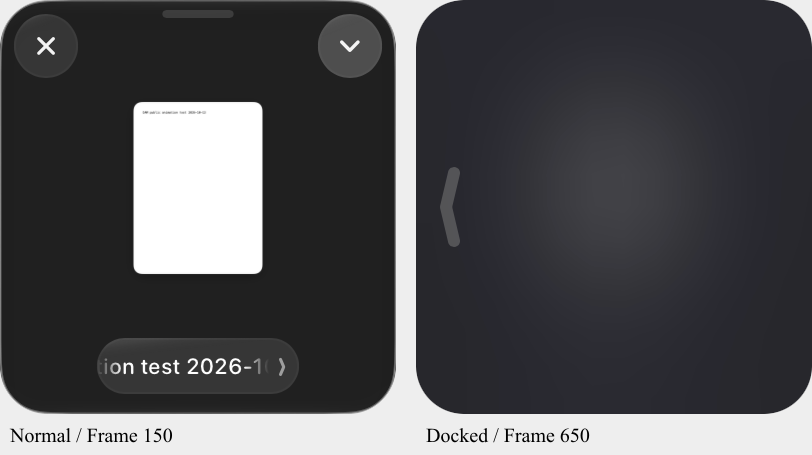

# Dropover 吸附模糊层：原版运行补证

2026-10-13，已在安装原版5.2.0执行停靠与弹出，同步采集指定公开小窗图像及真实进程调用栈。确认了上一版B遗漏的整窗原生模糊效果：停靠后原件缩略图模糊成柔和色块，关闭、菜单和底部按钮在视觉上消失，弹出后恢复。B当前只有颜色覆盖，尚未修改或补齐该视觉效果。

## 对象和执行

原版 `/Applications/Dropover.app`，5.2.0(653)，SHA256 `b0120976ab702cbd3eaca13e4e596bb5d4d6db8eeae776fb78e234b9d78b5294`。现存PID18449，主映像加载基址 `0x10432c000`，macOS27.0/arm64。仅操作公开生成测试窗 `DAM public animation test 2026-10-13.txt`，实际窗口ID30269、尺寸198×207，scale2。

CUA提升窗口后，右上可见下拉菜单可以执行“停靠到边缘”；这次是安装原版的正式菜单操作，不是坐标设置、内部方法注入或自制演示。完成右停靠，点击边缘弹出，再次停靠，最后恢复公开小窗。原子drag仍未产生原版窗口移动，因此本证据证明共同停靠覆盖效果，不能冒称拖动期间p>.4的提前预览已实测。

第一次按标题挑窗口的采集误选同标题工具提示，结果0帧，已保留并排除。随后改为已核对的窗口ID30269。有效完整区间 `confirmed-cycle` 有651图像/60秒，平均92.3ms、最大424.5ms间隔。图片是ScreenCaptureKit指定完整窗口，不是整个桌面，也不是固定60fps录屏。元数据在图像请求前采集；时序以frames.json原始单调时钟为准。

## 原生后端实际调用

后台使用系统 `sample`，20秒及60秒区间、请求每1ms采样线程栈；没有读取认证配置、进程环境、寄存器参数或堆内存转储。此工具是统计采样，会漏掉短调用，也没有逐调用时戳/参数；不能用采样次数冒称调用次数。

首次实际停靠区间 `installed-process-stacks.txt` 捕获到下列调用上下文：

| 原版运行偏移 | 对应静态地址/函数 | 实际命中 |
| --- | --- | --- |
| 0x7558 | 0x100007558，停靠completion范围 | 进入覆盖层show |
| 0x217390 | 0x100217390，show 0x1002172e0范围 | `NSView addSubview:` |
| 0x2176fc | 0x1002176fc，同show范围 | `NSAnimationContext runAnimationGroup:completionHandler:` |
| 0x217a60 | 0x100217a60，fade-in 0x100217a0c范围 | `_NSViewAnimator setAlphaValue:` → `NSView setAlphaValue:` → `CALayer setOpacity:` |
| AppKit/CoreUI | 系统材质渲染链 | `NSVisualEffectView updateLayer` → `NSVisualEffectViewCoreUIImpl updateLayer:withParameters:` → `_updateMaterialLayerWithinLayer:withParameters:` → `_makeMaterialLayerWithParameters:appearance:` → `CUICoreThemeRenderer::CreateOrUpdateVisualEffectLayer` |

首份栈1582–1619行把停靠completion、覆盖层show、淡入闭包及CALayer透明度更新直接串在同一采样上下文中；1141–1149行捕获材质合成。完整60秒栈又命中0x2175d0、系统材质更新、`NSVisualEffectView viewDidMoveToWindow`。这是实际执行证据，但各独立采样分支之间的完整调用顺序仍由静态调用链补充，不是完整无损trace。

60秒栈也出现过 `NSView _setHidden:setNeedsDisplay:`，但没有接收者身份/布尔参数，不能把它归到关闭/菜单按钮或吸附show。

## 静态结论与运行画面对照

同身份留存反汇编与安装包指针解析确认：`DragSessionOverlayView.effectView`是NSVisualEffectView。初始化 `0x1002639f4 → 0x100264e9c`；`0x100264f24`设置state=1(active)，`0x100264f38`设置blendingMode=1(withinWindow)。本机AppKit枚举也核对为1/1。withinWindow模糊的是同窗下层内容，符合实测纸张缩略图逐渐模糊的画面。[Apple文档](https://developer.apple.com/documentation/appkit/nsvisualeffectview/blendingmode-swift.property)。

`0x100264f6c`的24.0是圆角mask半径，不能当成高斯模糊半径。此初始化段没有证实CIGaussianBlur、inputRadius或显式setMaterial。原版整窗颜色变化由原生材质/底层窗口合成可解释，但独立纯色遮罩、具体色值和高斯半径仍未证实。`0x100264164`的颜色更新作用于抓手strokeColor，不是整窗色罩。

| 阶段 | 原版静态行为 | 留存证据 |
| --- | --- | --- |
| show | 首次四边约束添加覆盖层；alpha初始0；启动动画后立即写DragSessionView.interactionEnabled=0 | 0x1002172e0；ev_70b7c58328a996f1b080013e99b42f2319ca589f1870ee25913e041391108ad1 |
| fade-in | 0.3秒、alpha→1 | 0x100217a0c；ev_ab18a1e14d00a53ee9d50a7aa018a7cbcc04a2619152dee26964c51b5d8dea5c |
| show完成 | 更新抓手 | 0x100217a70；ev_8880124bd1973b63fef48c77545b92a6d0d7b7f3e885f93bbb063afa04ed41ae |
| hide | 先恢复interactionEnabled=1，再淡出 | 0x1002177f4；ev_c228de7fd2b1de9204848ded17fd76df1875c0a1fb6b839c28a1fbefb8b830a7 |
| fade-out | 0.3秒、alpha→0 | 0x100217adc；ev_dbd07c37fe2e0bb08ed847000893a3a1521d867eef664573f9c7e56703315371 |
| hide完成 | 清理过渡标记；覆盖层复用，不removeSuperview | 0x100217b84；ev_bf09357fc98c93b6acea6ec1c02d358ea95862af251fcd54f565e53bc31a42d2 |

show直接写交互字段，没有在该分支调用批量按钮hidden setter。`0x10004d5dc`等读取该字段后拒绝输入；不能把“不可交互”当成逐按钮isHidden=true。能确定的是最终画面全部按钮不可见、下层内容模糊、边缘抓手可用；底层按钮是否全部修改hidden属性仍未知。

## 连续帧

窗口始终198×207：

- frame90，8.450s：x2208，停靠模糊完整、原按钮不可见。
- frame91，8.566s：仍x2208，下层内容与按钮已经恢复；随后frame92/93移动到2149/2042，frame94在8.859s到2030。说明恢复内容与水平运动有重叠。
- frame507，46.846s：x2030，正常缩略图及按钮可见。
- frame508/509：x2149/2190，仍有清晰内容。
- frame510，47.094s：x2208，内容开始淡化。
- frame512，47.291s：同一终态x2208，缩略图已明显模糊，按钮近乎不可见。
- frame514，47.490s及frame650，59.994s：整窗原生模糊材质、仅剩抓手。

这是菜单停靠时移动完成后的覆盖层淡入顺序；不能外推成所有拖动分支都在运动完成后才显示。

完整联系图 `overlay-timeline.png`；原始图片和时间/位置在 `confirmed-cycle/frames.json`。`dock-effect-replay.mp4` / `.gif`与`restore-effect-replay.mp4`按原采样时间间隔生成回放，不插值、不冒称高帧率原始录屏。

## 对B的直接影响

上一版B的纯颜色overlay不足以复现此效果。对应修正应使用独立、覆盖整窗的NSVisualEffectView(active/withinWindow)，保留真实内容作为模糊输入；按原版show/hide生命周期控制材质淡入/淡出、内容交互和抓手交接，并验证全部原按钮视觉退出和恢复，不能只把按钮禁用或叠一层透明颜色。

本轮只补原版证据，没有修改B实现、原版签名/权限或安装REA引擎。B仍为dam-492930414aa9bcb7，Main/原生SHA与前一检查点一致。真正原生模糊及按钮视觉退出尚待B实现与新候选复验；原子拖窗、拖动中提前预览、高帧率及物理多屏资格仍保留未验。
