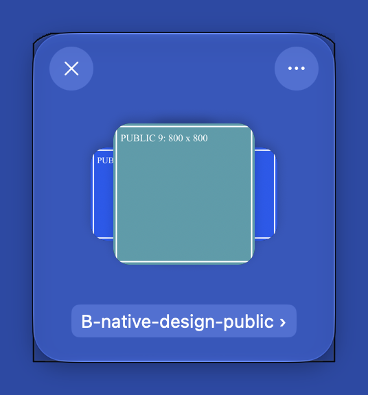
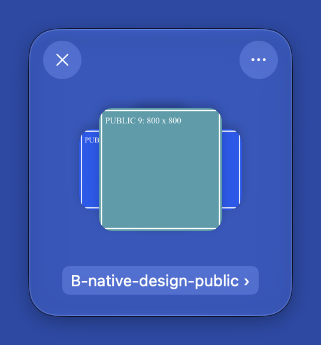

# B工作窗聚焦直角黑框：正式进程实时逆向与因果对照

2026-10-14。当前结论取代[此前报告](REPORT.md)中“聚焦黑线仍未定位”的阶段性判断。本轮只调研：产品代码/二进制未修改；唯一受控改变是正式公开窗的4秒运行时外形参数，已完整恢复，不作为实施修复。

## 结果

**已在正式运行窗口复现与用户附件相同的直角黑框。原因是原生窗口自身外形与玻璃形状不一致：窗口角半径0，玻璃角半径24pt；取得key appearance后，原生激活呈现仍沿窗口外形显示，形成玻璃之外的直角框。**

这是当前无边框NSPanel与全底板NSGlassEffectView接法的形状集成问题。没有发现额外旧矩形控件，也不是旧素材卡片描边。现有证据不支持把它归为“所有Liquid Glass组件都有的macOS缺陷”；系统内部究竟哪一服务端绘制例程产生每个像素未完全恢复，但控制变量的可逆对照已证明窗口外形参数是此异常直角轮廓的因果控制点。

## 对象

| 项目 | 绑定 |
| --- | --- |
| 实际OS | macOS **27.0（26A428）**，由本轮sw_vers核对，不能沿用旧macOS26运行假设 |
| 实际应用 | 本工作树 `out/main/shelf-candidates/DAM Shelf B.app/Contents/MacOS/Shelf` |
| 构建与SHA-256 | `dam-78f30cf9f4bc6f52` / `07267e86e50446f04a1bef02940918a2d48b53b457ee481d0795f5ae335d6488` |
| 进程/窗口 | PID68517 / Window37984，`B-native-design-public` |
| 资料 | 已指定9张公开生成图片；未读取其他资料库、凭据或输入内容 |
| 源码 | `c6f7903`，产品源码无本轮差异 |
| 工具 | 既有Frida17.7.3直接附加；无新安装、权限扩大、完整环境/内存/崩溃转储读取 |

REA原生调用工具仅支持启动自有新进程，不能用于这个已运行窗口的附加；此前LLDB在attach阶段退出。本轮用已安装Frida完成真实进程观察与短暂受控诊断，不能把Frida结果冒称REA提供的Evidence ID。源脚本、带时间戳事件及原始采集保存在 `.scratch/dropover-ui-refinement-20261014/`。

## 为什么早先工具看不到

有两处已取得证据的观察链差异：

1. **辅助功能聚焦文字不等于AppKit key状态。** 工具AX树显示聚焦元素是悬浮窗，但一次普通工具点击的实时读回仍为 `isKeyWindow=0`、`NSApp.isActive=0`。已记录mouseDown确实进入正式进程的 `NSWindow._handleLeftMouseDownEvent → WorkShelfRoot.mouseDown`，不能简单称没有输入。另一条实际鼠标输入经过 `_NSShowNonActivatingKeyWindow → becomeKeyWindow → _windowChangedKeyState`，窗口成为key。AXRaise也可以取得真实key，调用链为 `accessibilityPerformRaise → makeKeyAndOrderFront → makeKeyWindow`。当前尚未完全恢复自动化点击未取得key的底层原因，但“两个输入没有进入相同状态”已经是实测事实。
2. **早先截图配置可以排除framing。** 本机SDK `SCStream.h` 对 `ignoreShadowsSingleWindow` / `ignoreShadowsDisplay` 的定义是忽略窗口framing，并注明会忽略阴影；不能只按属性名称理解为“仅去阴影”。早期设 `ignoreShadowsSingleWindow=true` 的图不适合否定显示器上的外框。最终对照显式将两项都设false，用display局部合成，排除已识别的工具光标提示窗口，保留正式窗和其外缘。单窗滤镜与实际display场景的差别也见[Apple ScreenCaptureKit说明](https://developer.apple.com/videos/play/wwdc2022/10155/)。

原生面板规则参见[NSPanel.becomesKeyOnlyIfNeeded](https://developer.apple.com/documentation/appkit/nspanel/becomeskeyonlyifneeded)。本例运行读取root.needsPanelToBecomeKey=1、acceptsFirstResponder=1、becomesKeyOnlyIfNeeded=0；未将其当作“所有点击都必然激活”的证明。

## 正式运行时结构与调用

源码以 `[.borderless,.nonactivatingPanel]` 创建透明NSPanel，并直接将NSGlassEffectView铺满contentView，只设置玻璃 `cornerRadius=24`。运行时读到：

- 原生窗口 `_cornerRadius=0`、`_topCornerRadius=0`、`_bottomCornerRadius=0`，`_cornerPath=nil`。
- `_shouldGetCornerMaskFromVisualEffectView=0`，没有在这个接法中取得玻璃角部遮罩。
- 玻璃 `cornerRadius=24`，其内部实际包含24pt的圆角/裁切层；不能再仅凭外层CALayer.cornerRadius=0指责玻璃自身没有圆角。
- Frame容器为AppKit `NSNextStepFrame`。其未插桩方法 `drawRect:` 是 `needsFill → window.backgroundColor.set → NSRectFill` 背景填充路径，不是已经发现的黑线描边方法；`NSFrameView.drawFrame:`在所读入口为空。
- 实测key通知进入 `NSGlassEffectView._windowChangedKeyState`。未插桩代码与解析后的objc/import stub支持 `NSWindow.acquireKeyAppearance → _NSWindowSetHasKeyAppearance → SkyLight.SLSSetWindowActive`。最后一步说明原生激活状态进入系统绘制链，不单凭私有函数名推断黑线。

原始材料：`evidence/live-window-observer.ndjson`、`live-window-shape-getters.json`、`live-layer-state-inactive.json`、`live-appkit-method-code.json`、`live-appkit-resolved-stubs.json`。方法入口第一次读取到了Frida插桩跳板，另存为 `live-appkit-method-code-instrumented-entry.json`；最终原始方法在全部观察hook卸载后读取，未混淆跳板与AppKit原代码。

## 可逆A/B/A因果对照

在同一正式进程和窗口中，使用私有 `_setCornerRadius:` **仅作诊断**：原生窗口半径0 → 临时24 → 恢复原角配置对象及corner path。玻璃未修改，窗口持续key，位置和尺寸始终 `[1951,409,220,240]`（AppKit坐标）。

| 阶段 | 窗口自身圆角 | 玻璃圆角 | key/hasKeyAppearance | 实际结果 | 稳定区间帧数 |
| --- | --- | --- | --- | --- | --- |
| A：原状态 | 0/0/0 | 24 | 1/1 | 异常直角黑框及底部方形外轮廓 | 5 |
| B：临时窗口圆角24 | 24/24/24 | 24 | 1/1 | 额外直角框消失；正常圆角边缘仍在 | 18 |
| A：恢复原状态 | 0/0/0 | 24 | 1/1 | 相同直角黑框重新出现 | 48 |

原始形状：

临时对齐窗口形状，未裁切或重绘图片：

恢复原状态：

核对回执：[live-causal-receipt.json](live-causal-receipt.json)。源数据为 `evidence/live-corner-intervention.ndjson`、`live-corner-display-2/captures.json` 和 `correlated-captures.json`；选取的30/41/60号帧的采集开始/结束均在相应稳定区间，不拿跨状态帧当对照。采集使用自建不透明蓝色底窗，颜色参照用户公开截图；不是原桌面背景的逐像素复刻。全程只取指定公开窗覆盖区域，对其他前景窗相交时跳过，工具光标窗口40093单独排除。

原状态与恢复后的PNG字节完全相同（SHA-256均为 `fae0ae500dd6152d14b6c0324f18898afaa933751c398a16c201bba31633acd7`）。底部角点(48,527)在A/B/A中分别为RGB(8,12,24)/(43,70,154)/(8,12,24)，另两处黑线角点同样恢复；指标见[live-black-edge-pixels.json](live-black-edge-pixels.json)。这进一步排除了仅凭不同焦点或底色选择不同图片的解释。

## 保护与实施边界

恢复后已核对窗口上/下/总体角半径全部回到0，原corner radii对象及nil corner path恢复；玻璃仍24，frame不变。观察hook、诊断脚本和Frida会话均卸载/脱离，临时底窗关闭，正式应用继续运行。源码/二进制SHA不变，没有执行工作集内容编辑或Host文件操作。

中断后收尾再以一次短暂只读Frida附加核对原窗口，回执 `evidence/final-restoration-readback.json`；总体/上/下角半径仍0、玻璃24、cornerPath=nil。自有观察及诊断进程已退出，没有继续留置hook；没有把用户此前主动拖窗撤销回历史坐标。

私有setter验证了原因，**不能直接作为生产修复提交**。后续若获实施授权，应使用受支持的窗口配置或公共形状承载方式，保证窗口系统外轮廓、玻璃、阴影和命中区域一致，再验证真实鼠标、展开/收起、拖动、停靠和保存重开。此次不继续实施，不关闭之前父级功能票据，也不把受控参数切换称为正式修复完成。
