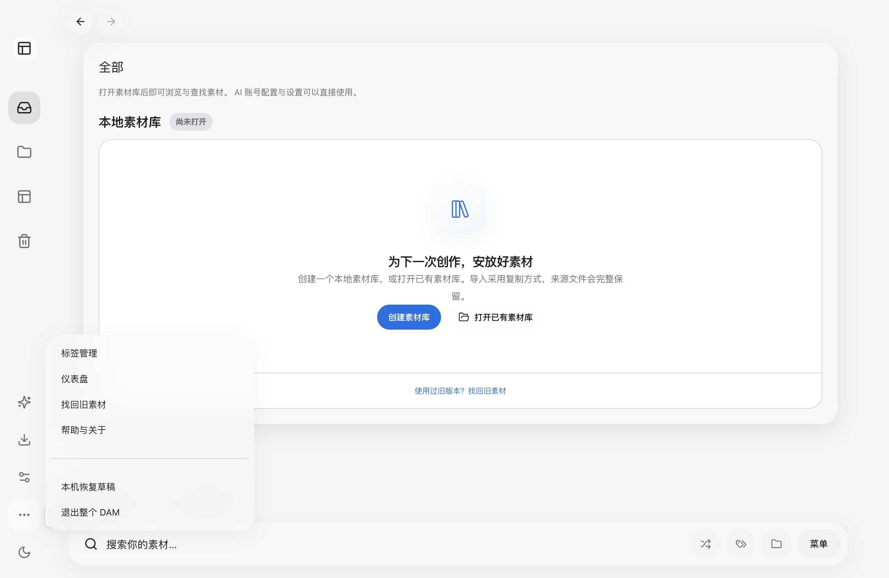
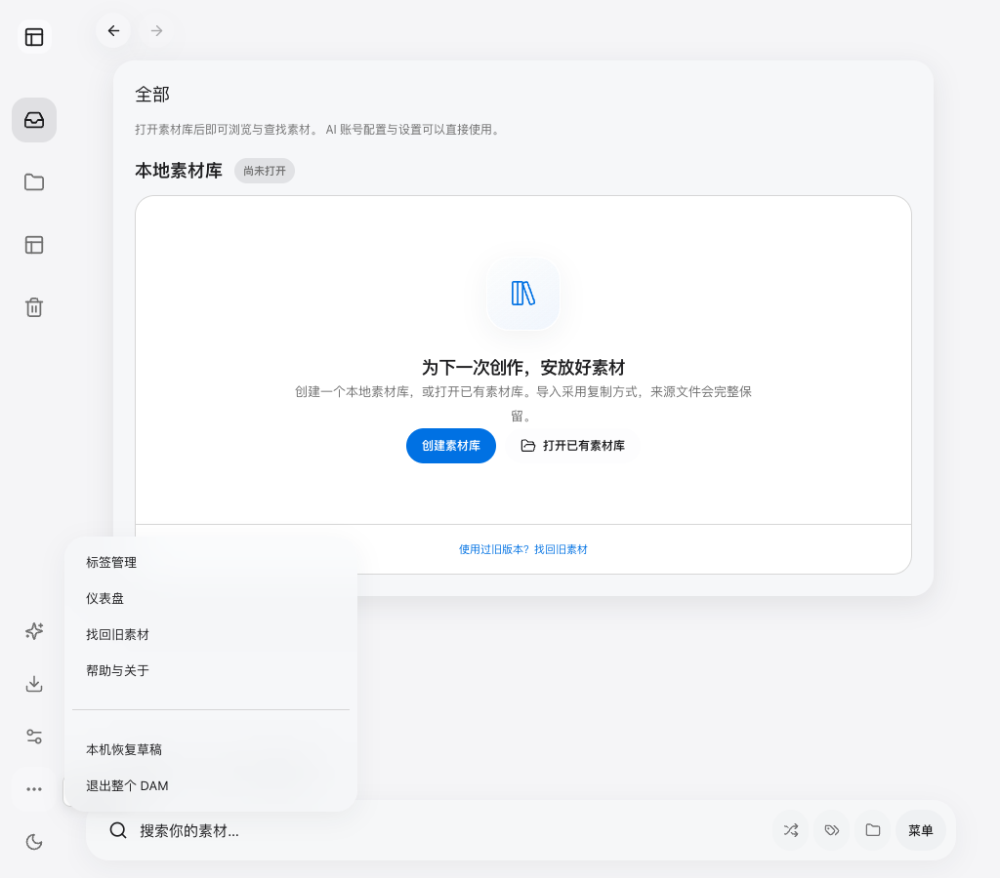
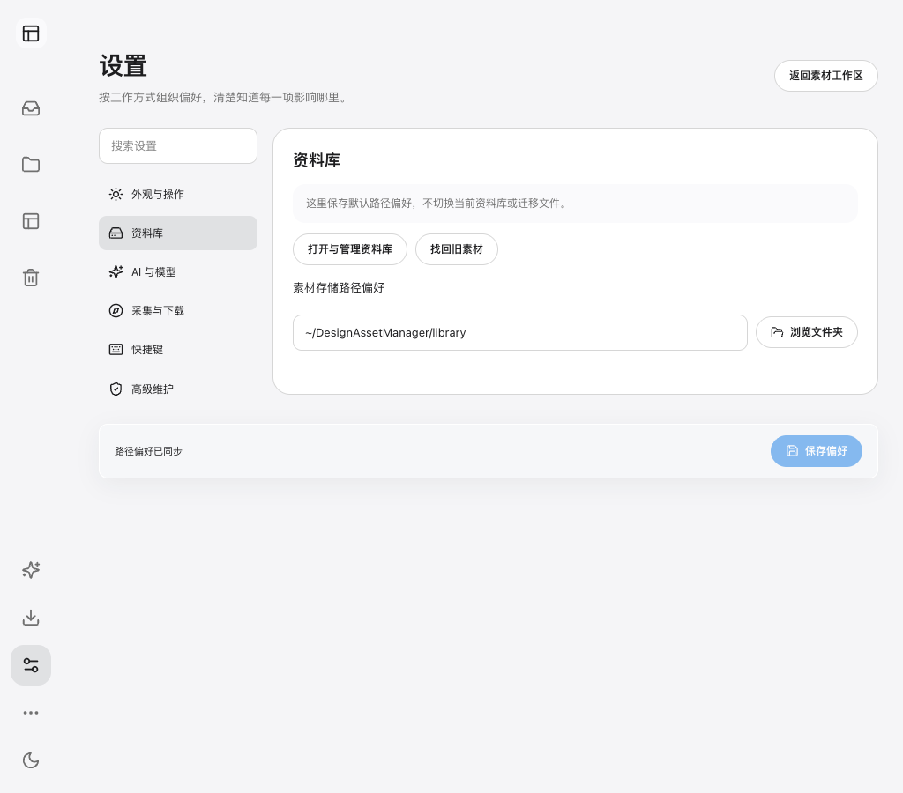
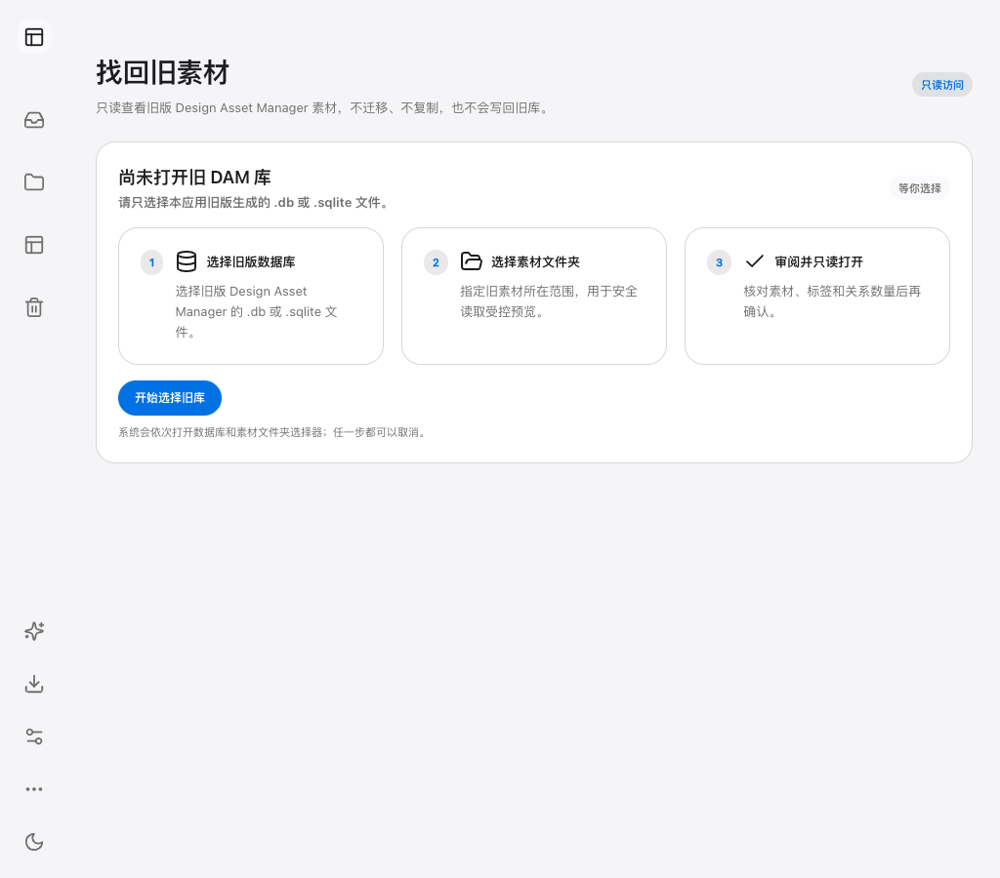

# 功能与菜单整理首项 · 2026-10-14

当前工作树基线为a7b7803，源码修改保留为未提交差异。正式帮助页核对候选为`dam-ebab19b0cac16211`，macOS arm64；没有操作用户资料库，也没有迁移或删除用户素材、笔记和外部原件。

用户可以从统一更多菜单进入标签管理、仪表盘、找回旧素材、帮助与关于，以及恢复草稿/退出。已停用的外部集成从菜单、设置、空库引导、路由、Client、IPC、Main启动/托盘/后台任务、预览协议、插件、构建脚本、测试、产品/设计/工程及历史文档中移除。历史混合报告只保留其他内容并标注清理，不把旧PASS当作新候选资格。Git历史仍是可恢复基线。

旧DAM库只读找回原先共用组合根，现由独立runtime、contract、client和IPC负责；七个命令保留信任检查、精确字段校验、身份/代次检查及只读保护。共享导航事件继续供工作窗配置AI使用。没有将本项扩展为删除其他菜单或工作集窗口。

## 启动与预览

从本工作树启动上次的公开预览副本：

```bash
npm run start:desktop -- --profile=/Users/meigong/.codex/worktrees/07c2/design-asset-manager-macos/.scratch/design-alignment-20261014/profile-v2
```

同一profile的旧Host应先从“更多功能 → 退出整个 DAM → 保留草稿并退出 DAM”正常退出，再启动新候选。当前旧进程没有被强制关闭。Browser可从“设置 → 高级维护 → 准备浏览器入口”进入同一Host，不复制账号或模型配置。

## 实际界面验证

Browser插件未提供，使用仓库已有Playwright Electron及独立Chrome，实际Main/Preload/Renderer、普通独立空profile；没有synthetic启动开关、注入Store、写用户库或推理动作。Browser视口1024×900，Desktop使用默认窗口。两端均从可发现控件点击：正式启动 → 更多功能 → 找回旧素材 → 打开正式选择器 → 取消 → 设置/资料库 → 正式帮助页。结束从正式退出审查保留草稿退出，Host退出码0。

| 检查 | 结果与范围 |
| --- | --- |
| 页面身份与非空内容 | 两端正式工作台加载，帮助页构建号一致 |
| 更多菜单 | 四个功能入口及恢复/退出项准确，无停用入口 |
| 设置与空库引导 | 本地库管理及旧素材入口可见，停用链接不存在 |
| 旧库取消 | 正式文件选择器可发现，取消不打开库、不留下审阅 |
| 渲染与截图 | 无页面异常/框架错误覆盖；Browser无水平溢出 |
| 控制台 | WARN：空库时Store加载诊断；Browser出现404控制台消息但response观察未定位来源，不宣称控制台洁净 |
| 旧地址回退 | 哈希路由回到默认素材页，属于补充路由检查 |
| 正常退出 | 浏览器保持连接参与审查，Desktop确认退出，Host码0 |

截图来自同一候选。实际结果见[validation.json](validation.json)。旧库真实源选择、完整素材业务、物理原生指针、多屏及Windows/Linux未在本轮新验；原设计实施的AI/OCR等旧资格不转记。

## 内部检查与源码审查

类型检查、正式build、design:check、app-navigation、app-ipc-registration、legacy-readonly-workspace、local-dam-client、local-dam-launch、browser-unknown-commit、receipt-authority、256文件选择并发限制、context:check与agent-context-router均通过。旧库测试通过真实SQLite及Client/IPC回读，覆盖不可信请求、额外路径字段、过期预览代次与数据库字节/stat/sidecar不变。修改后的当前测试均已运行；没有重复运行全量发行/模型CI。档案中的清理后脚本不转记为重新执行的历史资格。

按code-review直接检查调用方、职责、保存/退出与权限边界；这是同会话审查，不是独立第三方审查。修复遗漏的侧栏路由图标，保留共用导航消费者，并更新注册测试对固定循环与原生工作窗通道的覆盖。context:check通过，但四个新增first-party文件尚未进入Git索引，因此该检查注明其暂未计入trusted ownership覆盖；类型、构建和IPC测试已覆盖这些文件。

最终工作区文本/文件名及构建产物扫描没有停用集成标识或执行接线；git diff --check通过。专属文件删除与历史混合内容清理可在当前差异中审阅。

## 截图





