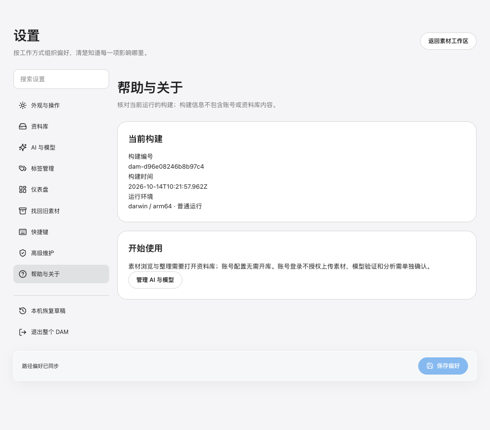
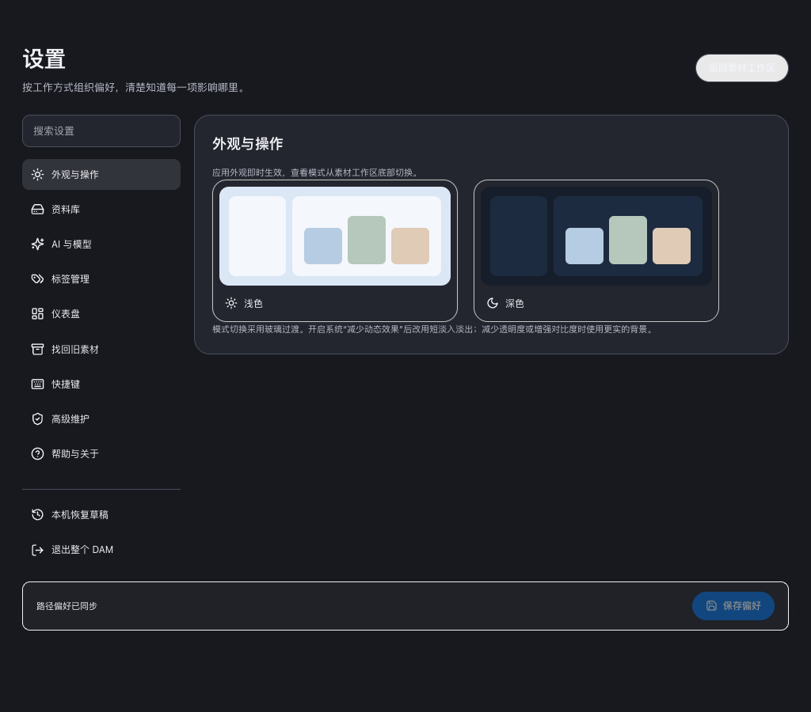
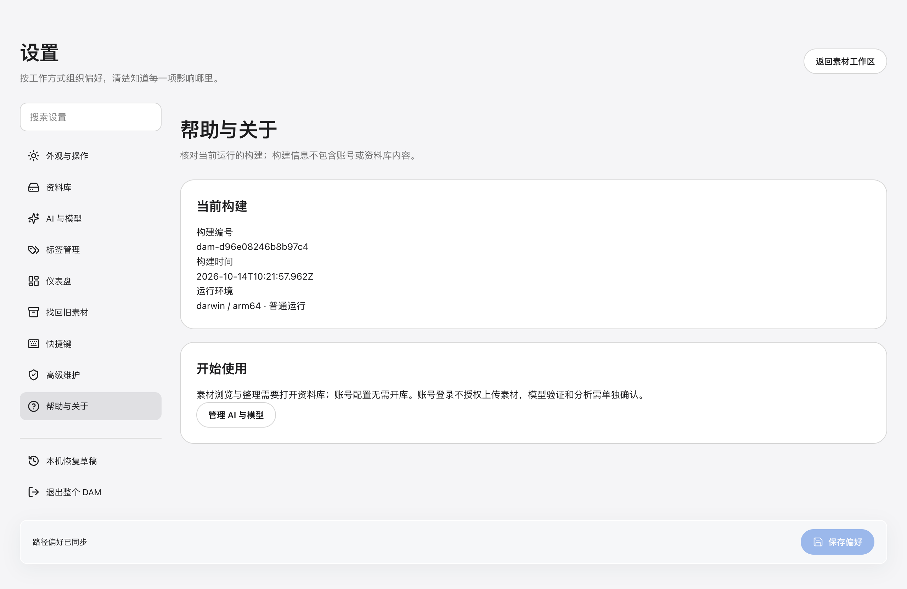

# 全窗口设置与模块清理 · 2026-10-14

用户现在从主工作区“设置”进入整个主窗口的设置表面，主页菜单栏、导航及素材搜索栏不再显示。AI与模型、原更多功能中的标签管理、仪表盘、旧素材找回、帮助与关于，以及本机恢复草稿/退出，均可直接在设置内使用。主工作区底部只保留设置和主题切换。设置中仍有明确返回素材工作区入口。

候选`dam-d96e08246b8b97c4`由正式帮助页核对，macOS arm64；当前工作树基线a7b7803加本地未提交差异，包含上一轮停用集成清理。源码与构建产物已更新，当前旧预览进程没有被强制关闭或自动替换。不推送、不发布。

## 实现与数据边界

应用级功能的唯一目标为`/settings/*`，旧AI/标签/概览/旧库/帮助地址仅保留兼容跳转。设置分类共享一个页面生命周期，路径草稿跨分类保留；原并发保存基准、冲突检查和明确采用仍有效。配置账号、模型及背景分析保持原执行/权限语义，配置不授权外发素材。

素材任务中心和采集下载偏好页被删除，下载执行器、队列/历史服务、Store、Client/IPC、菜单、旧路径计划及专属测试不再存在。仪表盘也不再显示下载统计。原混合AI/下载测试的AI部分保留为独立`visual-ai-intake.integration.test.ts`，不以删除下载模块抹掉AI保护用例。

本地复制导入、剪贴板入库、图片派生副本、模型制品下载、AI内部任务记录、已有原件及用户编辑保留。旧v3表定义移到Library生命周期的兼容模块，后续版本仍可识别既有schema；已存意图/块记录不被删除、重放或联网恢复。已有资料库、账号/凭据和用户素材未被操作。

## 启动

在本工作树运行上次的公开预览副本：

```bash
npm run start:desktop -- --profile=/Users/meigong/.codex/worktrees/07c2/design-asset-manager-macos/.scratch/design-alignment-20261014/profile-v2
```

同一profile的旧Host先从可见退出入口保留草稿并正常退出，再启动新候选。Browser入口现在位于“设置 → 高级维护 → 准备浏览器入口”，仍连接唯一Host。

## 实际界面验证

未提供Browser技能，使用项目已有Playwright Electron和独立Chrome，真实Main/Preload/Renderer与普通隔离空profile。Browser为1024×900，Desktop为默认窗口；没有synthetic启动开关，没有注入Store/IPC作为用户路径，也没有配置真实账号、资料库或推理。

两端从主页可发现设置入口点击：设置 → 资料库输入未保存路径 → AI各子分类 → 返回资料库核对输入 → 标签/仪表盘/旧素材 → 正式选择器取消 → 草稿恢复 → 帮助 → 明暗外观 → 返回素材工作区。Browser实际保存路径偏好，Desktop读取同一结果，再从设置内正式退出审查保留草稿退出。重新启动同一profile，设置回读正确，随后正常退出。

| 检查 | 结果 |
| --- | --- |
| 页面身份、非空及构建号 | 两端正式页面，帮助页候选一致 |
| 全窗口布局 | 主导航/主页素材搜索/底部素材工具不存在，设置stage占满shell宽度 |
| 功能整合 | AI五分类及原更多功能均在设置内可发现 |
| 模块删除 | 任务中心、采集下载分类及素材下载Client/IPC已移除 |
| 输入与保存 | 路径草稿跨分类保留；两端保存同步，退出重开回读正确 |
| 取消与退出 | 旧库正式选择器可取消，草稿恢复可返回；退出仍经过原审查 |
| 渲染 | 本轮实际路径无pageerror、无框架错误覆盖；Browser无水平溢出 |
| 控制台 | WARN：空库Store加载与Browser 404提示仍在，不宣称控制台无错误 |

机器结果见[validation.json](validation.json)。截图来自该候选。该资格不替代真实素材整理/AI质量、物理原生输入、多屏、Windows/Linux或签名安装验收。

## 内部验证与缺口

通过：typecheck、正式build、design:check、app-navigation、app-ipc-registration（305个唯一注册通道）、app-storage保留旧表数据、workspace-motion、settings-view的八个冲突/晚输入/未知提交回归、asset-workspace-session、library-quiescence、local-dam-client、browser-unknown-commit、receipts、旧库只读、Copy准入与持久化、库manifest/open检查、CI配置治理、context:check及context-router。标签意图/执行/决定与后台分析的SQLite回归通过，旧存下载行在升级/重开后仍保留；冻结旧schema源码保持原字节，仅在编译夹具时重定向兼容schema模块。剪贴板入库及原件/副本保护测试通过。

扩展检查未闭合：旧asset-library-keyboard夹具没有当前`searchAssetsPage`，在素材按钮检查前超时；后台OCR扩展运行停在已报告14个子项之后，视觉AI混合测试保留下来的独立回归运行挂起；旧综合Electron入库/工作台脚本也未完整执行。这些均未登记为PASS，没有通过删除保护或降低断言关闭。正常产品两端设置路径已单独完成；后续修旧夹具应重新核对当前正式Client，不能据旧脚本失败直接推定真实功能失效。

按code-review在同会话审查直接调用方、路由、资料权威、退出及注册保护；不是独立审查。实际运行发现并修复分类转场卸载导致路径草稿丢失，以及拆除下载初始化时误删相邻注册段的问题；最终候选已重建并复验。未触碰工作集悬浮窗实现。context检查仍注明未提交新文件未计入trusted ownership覆盖；类型、构建和聚焦运行包含这些文件。

## 截图




