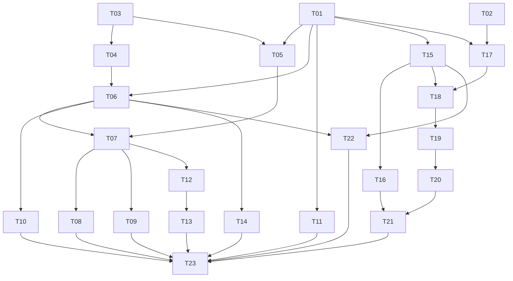

# 本地 AI 底座切片与范围

2026-10-10 收口：Mac 迁移实施、当前适用 T23 联合路径和 bug 收敛已完成；尚未实测的组合/平台/系统项已转入 [统一待测清单](../../handoff/DEFERRED-ACCEPTANCE.md)。窗口交互扩展暂停，云上传/分享取消。完成台账见 [本轮收口](../../handoff/MACOS-DELIVERY-CLOSURE-20261010.md)。

来源：[父规格 #24](https://github.com/zhr0210/design-asset-manager/issues/24)及[本地规格](../../product/LOCAL-AI-FOUNDATION-SPEC.md)。T01–T23 是本地切片，23 张 GitHub 子 issue 尚未发布。T01–T22 的实现收尾与所有组合验收分列；T23 全量与父 #24 保留未完成，未修改远端 issue。

原拆票及各候选时间记录已 [归档](../../history/handoff-snapshots/macos-20261009-20261010/TICKET-PLAN-before-closure.md)。以下保留目标和依赖，删除不存在的临时子票链接；不重新形成执行队列。

## 切片目标

| 计划ID | 标题及完整草案 | Blocked by | What it delivers |
| --- | --- | --- | --- |
| T01 | 统一现有 CPU/OCR 资源行为与正式状态 | 无 | 保留CPU视觉分析与OCR，让它们使用唯一准入、可见忙闲/等待状态及实际退出后的释放；在可运行路径内先完成必要prefactoring。 |
| T02 | 已验证模型离线使用与来源新鲜度分离 | 无 | 用户断网继续使用已验证、未漂移/撤信任的模型，分别看到本地资格与最后在线来源检查。 |
| T03 | 完整境内量化组合目录与选择 | 无 | 用户通过ModelScope浏览完整相关Qwen3-VL目录，按语言量化与视觉投影选择准确组合，看到来源、许可、容量、镜像缺失和真实支持状态。 |
| T04 | GGUF 下载、导入、核验与库存恢复 | T03 | 选定GGUF组合完成正式恢复下载或只读/复制导入，完整核验后入库存，重开可明确恢复或放弃。 |
| T05 | 真实 RAM/逐 GPU 余量与量化推荐 | T01、T03 | 按新鲜RAM/逐GPU余量推荐组合，用户选择偏好和GPU/混合/CPU方案，理解不足、慢速或未知原因。 |
| T06 | 受管 GGUF 2B CPU 验证、分析与重开 | T01、T04 | 安装固定受测运行包，真实验证2B Instruct GGUF CPU组合，在素材入口分析并保存重开。 |
| T07 | GGUF 2B GPU 与混合加载正式路径 | T05、T06 | 同一2B模型/量化在GPU完整或混合方案中正式验证和分析，实际计划、成本与释放可核对。 |
| T08 | GGUF 4B Instruct 推荐到真实使用 | T07 | 4B Instruct GGUF经推荐、安装和实际支持的CPU/GPU/混合资格完成素材分析及重开。 |
| T09 | GGUF 8B Instruct 推荐到真实使用 | T07 | 8B Instruct GGUF经完整安装和实际支持的加载计划完成验证、素材分析与保存重开。 |
| T10 | 正式标签/描述约束生成与严格校验 | T06 | 正式GGUF分析采用受约束输出减少可避免格式失败，仍完整校验并逐能力保存。 |
| T11 | 一键分析准备复用、缓存失效与显式重跑 | T01 | 正式基础分析复用兼容准备材料和驻留，明确重跑产生新尝试，缓存不串素材或删除保存结果。 |
| T12 | 同模型加载调节、驻留与桌面压力收敛 | T07 | 平衡/省资源/响应优先中自动选择同模型已验证加载方式，压力回收闲置、让出后台并保护活跃任务。 |
| T13 | 一次有审计的本地 OOM 恢复 | T12 | 明确本地OOM且未保存结果时，清理/复核后以同模型已验证低占用方案最多恢复一次。 |
| T14 | GGUF 生产后台派发、取消与中断核对 | T06 | 新素材经明确规则走GGUF生产后台，用户可暂停、取消并在重开后核对未知或明确恢复。 |
| T15 | 统一中文文字检索、增量索引与稳定分页 | T01 | 正式工作区由Host增量投影搜索全部既有字段和中文组合，按稳定页返回结果与依据。 |
| T16 | 文字索引落后、损坏与代际重建恢复 | T15 | 索引落后或损坏时显示覆盖和恢复，资料/可用搜索保持，新代次完成后安全切换。 |
| T17 | 独立本地检索模型安装、离线与图文验证 | T01、T02 | 明确准备许可清楚、中英文/图文能力可验证的本地检索模型，完成安装、真实资格和离线回读。 |
| T18 | 明确范围生成持久向量与可恢复覆盖 | T15、T17 | 用户选定素材范围生成canonical embeddings，查看覆盖/等待/失败，暂停重开恢复并保留文字搜索。 |
| T19 | 中英文自然语言语义找图与混合命中解释 | T18 | 中文、英文或中英混合描述画面，跨描述/标签语言得到硬条件约束的语义/文字混合结果、稳定分页和具体依据。 |
| T20 | 库内与外部单图的以图找相似素材 | T19 | 从当前素材视图或正式选入/拖入一张外部图做本地相似检索，得到依据且无隐式收录或外发。 |
| T21 | 检索空间升级、向量索引重建与回滚 | T16、T20 | 更换检索模型或恢复向量索引时旧搜索保持，新空间验证后切换，持久向量与用户内容保留。 |
| T22 | 正式任务阶段诊断与质量/性能版本对照 | T06、T15 | 用户从正式诊断入口查看实际任务的等待/错误、阶段耗时与组合版本，维护者能按同样本核对质量和资源效果。 |
| T23 | 真实应用联合闭环与当前版本证据 | T08、T09、T10、T11、T13、T14、T21、T22 | 主Agent将全部切片组合为普通用户闭环，交付准确启动、当前候选、真实模型/检索/资源操作及保存重开证据。 |

## 实际依赖

## 范围与检查

- T01–T22映射覆盖父规格User Stories 1–70；T23负责当前候选联合验收，局部通过不关闭父级。
- 阻塞边是实际能力前提，不按文件归属/编号串成单链；原规划frontier为T01、T02、T03；该图只说明依赖，不是当前执行队列。
- T10约束生成使用已工作原生路径；T11准备复用可适用于已有CPU/OCR，不等待全部GGUF规模；T12调节已验证GPU/混合/CPU方案，T13复用它完成一次本地恢复。
- T15交付完整文字路径，T16补代际/故障；T17独立双语模型安装/资格，T18持久向量范围/覆盖，T19中英文查询建立语义索引/混合排名，T20复用它接单图授权，T21补新空间切换/恢复并复验双语。T22在实际分析/文字查询上接阶段诊断与版本对照，T23核对所有消费者的联合双语证据。

未发布子 issue 不影响已经授权的实施；后续发布需另定范围。本轮停止于本地任务收口。
