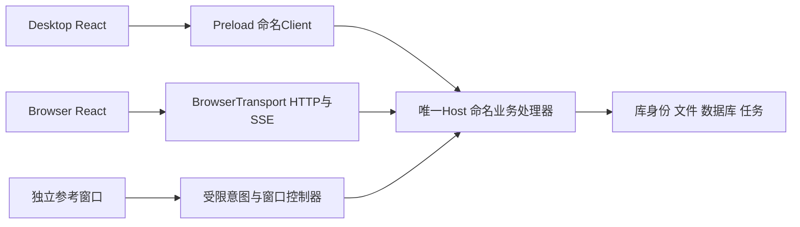

# GUI系统：界面外壳、状态与跨端协作

本页说明当前源码中的界面系统怎样运行，包含React页面、命名Client、可信Host与原生窗口的协作；是功能/机制索引及运行说明，不是前端目录清单或运行通过声明。返回[子系统目录](README.md)。按问题读相关章节，不必每次装入全部界面历史。

## 按场景定位

| 问题 | 本系统正文 | 业务拥有者 |
| --- | --- | --- |
| 启动/Client/导航与外壳 | [启动与Client](#启动与client安装)、[页面生命周期](#页面与外壳生命周期) | Host会话/通信 |
| 列表、详情、专注与素材选择 | [内容页面](#asset-workspace) | [Library内容](library-lifecycle.md#organization)、[检索](asset-discovery.md) |
| 设置导航、输入/草稿、断连恢复 | [设置界面](#settings-ui)、[校准屏障](#browser断连校准与未知提交) | [Host配置/路径](local-host.md#configuration)、[Library旧库](library-lifecycle.md#legacy) |
| 默认窗口、macOS B、原生参考与预览 | [参考窗口](#reference-windows) | [Library成员/修订](library-lifecycle.md#organization)、[Host文件交接](local-host.md#handoff) |

这里只拥有呈现/输入与跨层协作说明。界面里的数据、推理、路径、文件交付仍由各系统拥有者处理；视觉见DESIGN，用户动作见INTERACTIONS，检验方式见真实验收流程。

## 职责与状态权威

| 问题 | 唯一正文/拥有者 | 本页的边界 |
| --- | --- | --- |
| 颜色、材质、字体、布局尺度、组件样式和通用反馈/动效 | [DESIGN](../../DESIGN.md) | 链接适用设计，不另抄token、写实施日志或将当前实现当批准设计 |
| 用户入口、输入、保存/取消和功能交互 | [工作台交互](../design/INTERACTIONS.md#workspace)、[工作窗交互](../design/INTERACTIONS.md#work-window)及所属产品规格 | 说明实现如何消费行为契约；新行为要求回规格确认和写回 |
| 外壳、启动、路由、会话、传输、状态投影和恢复机制 | 本页，局部实现归源码旁README | 跨层协作以本页为入口，具体领域算法/状态机归相应模块 |
| 实际版本、能力/平台资格及验收证据 | [CURRENT-STATE](../handoff/CURRENT-STATE.md)与本任务报告 | 以下源码接线不证明实际屏幕、安装包、模型或原生体验已验收 |

### 组成与源码入口

| 部分 | 当前责任与状态 | 关键源码/符号 |
| --- | --- | --- |
| 可信桌面Host | 创建主窗口，注册业务/传输，拥有库身份、文件、数据库、账号与执行；不是前端Store | [Main](../../src/main/index.ts)的`createWindow`，业务链查[Local Host](local-host.md) |
| Renderer启动 | 区分普通工作区、单素材卡片和Electron工作窗；普通路径先安装Client再导入App | [main.tsx](../../src/renderer/main.tsx)的`startWorkspace`、[workspace-client.ts](../../src/renderer/workspace-client.ts) |
| 共享路由/外壳 | HashRouter组成普通页面；AppShell持有会话、全局参与者/覆盖层，设置子路由共用Settings实例 | [App](../../src/renderer/App.tsx)、[AppShell](../../src/renderer/components/layout/AppShell.tsx)、[导航workflow](../../src/shared/workflows/app-navigation.workflow.ts) |
| Client与平台传输 | 同一命名产品API；Desktop由Preload适配IPC，Browser由HTTP/SSE适配。Transport不作为Renderer任意调用全局暴露 | [Client工厂](../../src/shared/client/workspace-client.ts)、[Preload](../../src/preload/index.ts)、[BrowserTransport](../../src/renderer/browser-transport.ts) |
| 会话与展示状态 | 会话投影Host身份/代际，Store管理列表、选择和输入；不是第二份持久数据库/库授权引擎 | [createAssetWorkspaceSession](../../src/renderer/asset-workspace-session.internal.ts)、[Renderer局部说明](../../src/renderer/README.md)、[素材专题](gui-shell.md#asset-workspace) |
| 设置编辑 | 表单输入与原基准分离；expected随补丁提交；冲突采用、选择器和恢复均保留明确用户动作 | [Settings](../../src/renderer/routes/Settings.tsx)、[设置专题](local-host.md#configuration)、[settings.store](../../src/renderer/stores/settings.store.ts) |
| 独立参考界面 | 单素材卡片、默认Electron工作集窗和macOS B候选有不同桥与生命周期，不能因页面相似共用权限 | [卡片模块](../../src/main/asset-card/README.md)、[工作窗模块](../../src/main/work-mode/README.md)、[工作模式专题](gui-shell.md#reference-windows) |

## 正式入口与运行链

### 启动与Client安装

普通入口由package.json中的`start:desktop`或`start:browser`启动/连接同profile的Host，过程见[Local Host模块](../../src/main/local-host/README.md)。Desktop主窗口在`createWindow`绑定Preload；Preload构造命名Client并暴露`damClient`。Browser通过既有一次性入口和本机会话校验连接，不传递浏览器Cookie或让Agent读取认证内容。

`startWorkspace`先识别专用`assetCardAPI`/`workWindowAPI`，有专用桥则装载对应独立React表面并返回。普通工作区先取已安装/Preload Client，否则创建BrowserTransport，再安装Client、动态导入App和Store消费者。这样模块不会在桥尚未安装时缓存“无Client”。连接初始化失败在根元素呈现固定恢复指引；不能把失败当空素材库。

### 页面与外壳生命周期

`App`默认进入`/library`，`/settings/*`的AI、标签、仪表盘、旧库与关于页面嵌入Settings；旧地址通过导航workflow的别名兼容，不能据旧route存在恢复退休模块。精确入口和用户行为见[应用页面导航](../design/INTERACTIONS.md#workspace-应用页面导航)。路由字符串是实现定位，不是正式验收中直接跳转的替代。

`AppShellContent`对Library和Settings隐藏外壳的旧WorkspaceRail，页面各自呈现对应导航；外壳仍挂载认证、文件选择、恢复、连接和退出/切库覆盖层。`WorkspaceEntrance`在整个设置子树使用稳定`/settings`键，不能改为每个子路由重建并卸载草稿拥有者。Settings的嵌套`Outlet`换页时保留外层路径表单。技术入口见App/AppShell/Settings，具体可见分类/搜索范围以交互规格为准。

### 状态投影与事件

`createAssetWorkspaceSession`检查Host projection的状态/身份/代际，并用inspection sequence、scope lifetime、route/app lifetime淘汰旧异步结果；`ready`还须有identity/generation。只在当前投影有效时加载素材/标签，卡片返回须重新inspect Host，不能把旧窗口状态带进另一库。

AppShell订阅设置、库变化、工具/OCR/AI完成、卡片变化/返回及工作集定位事件，交给对应session或Store更新；卸载注销订阅并使旧回调失效。事件是刷新/定位线索，不授予提交权限；列表/搜索、笔记和工作集的详细状态分别查[素材](gui-shell.md#asset-workspace)、[检索](asset-discovery.md)、[组织](library-lifecycle.md#organization)及[工作模式](gui-shell.md#reference-windows)。

## 失败、取消与兼容保护

### Browser断连、校准与未知提交

BrowserTransport有`connected`、`reconciling`和校准序号。SSE连接/恢复触发`reconcile`：先标不可写，读取库、设置、旧库、账号等快照，再等待已挂载的`onReconcile`处理器完成。AppShell校准会刷新session和设置，检查必要列表/标签错误；只有当前序号全部成功才发布connected。收到连接事件、网络重新可达或一个GET成功均不等于已经恢复业务写资格。

断连/校准期间只允许明确列出的读命令和`workspace:ready`，不队列化/自动重放写入。HTTP已发而回执丢失、授权失效或回执不完整使用`WorkspaceConnectionError`表达不确定性；提示核对保存结果，不断言服务端未写，也不自动重试。Host端的调用序号、角色和重复准入另见[传输模块](../../src/main/local-host/README.md)。

[WorkspaceConnection](../../src/renderer/components/layout/WorkspaceConnection.tsx)把连接指引portal到业务冻结层外，区分校准中和断连；恢复操作仍可发现。session对标记`preserveDrafts`的连接错误保留当前输入投影；其他无法确认库权威的inspect失败进入recovery-required并清理失效列表。两类失败不能统一当空态或清空所有草稿。

### 设置基准、草稿与旧响应

Settings的`libraryPath`是本地输入，`baseline`是开始编辑时的保存基准；后台设置更新只重基未编辑字段，双方都变更则提示冲突。`handleSave`构造patch/expected；明确采用新基准不等于保存输入。当前底部保存条只保存路径偏好，不能把它描述成所有AI配置的全局保存。更改此交互需更新所属规格，不能仅改系统说明来宣布新行为已交付。

会话输入、Host收到的恢复草稿与已提交Library内容分别计数；本机sessionStorage不是业务数据库。写入顺序、writer身份、恢复采用/丢弃和过期读响应由[workspace-drafts](../../src/renderer/workspace-drafts.ts)与Host草稿拥有者协作，细节见[Local Host模块](../../src/main/local-host/README.md)。选择器取消、保存失败和未确认提交保持输入；不能通过路由卸载规避草稿审查。

### 关闭视图、切库与退出

AppShell经[connectTransitionParticipant](../../src/renderer/workspace-transition-participant.ts)参与Host flush：按请求冻结输入、刷新额外草稿并持久暂存，再返回ACK及transient状态。未连接/失败的参与者不能被算作已flush；`beforeunload`只是额外笔记/OCR保护，不替代Host全局退出协议。

[WorkspaceTransitions](../../src/renderer/components/layout/WorkspaceTransitions.tsx)展示Host审查并请求confirm/cancel，不自行认定所有窗口安全。Host的[createWorkspaceTransitions](../../src/main/local-host/workspace-transitions.ts)在confirm时再次flush/比较fingerprint，变化则更新审查要求重新确认；确认期间暂停过期计时，取消/失败按相应状态解冻并保留恢复信息。不能用删除确认层或本页没有dirty代替全参与者审查。

主窗口close不等于退出：当前Main在仍有工作集窗时隐藏主窗口；关闭其他表面与“退出整个DAM”的效果也不同。Host/排空细节归[生命周期专题](local-host.md)和对应模块，本页不另维护第二套退出状态机。

## 技术与平台边界

主工作台/设置使用React、TypeScript、Router、Zustand和项目样式，Desktop与Browser共享；Electron负责平台窗口/生命周期。默认工作集窗也是Electron/React。Main仅在macOS且带`--dam-work-window-candidate=b`时选`createNativeShelfWorkWindow`，否则用`createElectronWorkWindow`；`start:work-b`是候选入口，不是默认产品路径。

B使用Swift/AppKit的NSPanel/NSCollectionView等原生组件，不是SwiftUI，也不在AppShell React树内；它只通过受限快照/意图与Host控制器协作，React可承担其专用大预览。视觉语言可共用，不能据此把所有窗口改成同一React进程或下放保存/成员/交付权威。技术矩阵和原生选择依据见[架构](../../ARCHITECTURE.md)、[ADR0493](../adr/0493-dropover-style-interaction-allows-platform-native-implementation.md)及工作窗模块。

Web模糊不等于系统Liquid Glass；现有原生材质接线不证明已达到DESIGN目标。Browser共享UI、macOS原生窗口、Windows原生/安装和媒体helper各自验收，不用一个客户端截图或构建结果代表全部。本文不为文档任务启动UI、模型或安装操作。

## 内容页面与设置导航

本系统拥有页面/窗口呈现和输入生命周期，不拥有页面所调用的业务数据库或任意文件权限。设置导航、选择/焦点/草稿与资料库迁移必须按拥有者分开。

### 素材列表、详情与共享展示

**职责与状态权威。** 共享React负责导航、选择、焦点、编辑草稿与可恢复交互；Host拥有素材/标签/分析提交。asset.store不成为第二份持久数据库或全库检索权威。原型保留视觉研究身份，不将其localStorage当生产持久化。

跨页面外壳/会话、桥安装、迟到事件和连接恢复从[GUI系统说明](gui-shell.md)进入；本专题负责素材列表/详情/专注协作，视觉仍归DESIGN，输入行为归对应交互规格。

**正式入口与运行链。** 普通主入口→Library/Canvas→受控预览与有界Host列表/查询→Inspector或独立专注。选择与滚动独立于后台行刷新；详情人工编辑通过Client→Host保存再回读。单素材原生卡片是有更窄scope的独立窗口，不等于工作集B窗。

**失败、取消与兼容保护。** 等待/失败保留旧可用结果和输入，旧异步应答不能覆盖新选择；切库/退出检查草稿。空库、加载失败、缺权限不是同一种空态。文本输入保持键盘语义，布局/动效/焦点按交互规格，不在模块README复制设计token。

**当前内容与迁移。** 整合后的工作集仅保存name/assetIds/columns；v16按[ADR0494](../adr/0494-work-sets-retire-own-notes-and-palettes.md)显式备份退役工作集自己的备注和用色，素材Notebook、独立色板及原件保留。数量调档、设备指示器/Space与系统副本动作的局部机制见[工作窗模块](../../src/main/work-mode/README.md)。旧资料库只读打开不触发退役。

**技术与平台边界。** Desktop与Browser共享页面；macOS工作集AppKit不由本模块渲染。1024/1440共享UI与系统窗口分别验证，正式可见入口不以直接route或注入Store代替。

### 设置的表面与草稿

设置分类、搜索范围、草稿生命周期与旧路由的当前行为见[工作台交互：应用页面导航](../design/INTERACTIONS.md#workspace-应用页面导航)；呈现见[DESIGN：配置、任务与其他应用页面](../../DESIGN.md#配置任务与其他应用页面)。评估整合时先区分现行约定、源码偏差与拟改变的体验，不把可改进的现行约定直接称作实现缺陷；AI连接管理另见[连接专题](ai-system.md#connections)。

设置页面生命周期沿本页原有设置基准/路由章节；配置持久化与路径迁移查[Host配置维护](local-host.md#configuration)，旧库与恢复数据查[资料库](library-lifecycle.md#legacy)。页面出现某项能力，不把其执行权威归给GUI。

### 参考窗口与原生呈现

**职责与状态权威。** Host持有Library、工作集内容/成员/修订、保存、文件任务与撤权。设备布局与库内内容分开。macOS B的Swift/AppKit子进程负责NSPanel/NSCollectionView、输入、窗口frame与动画；React保留主工作台及按需独立大预览。

**正式入口与运行链。** 默认start:desktop/start:browser连接普通Host，work controller默认createElectronWorkWindow；只有--dam-work-window-candidate=b（start:work-b）在macOS选createNativeShelfWorkWindow。B通过正式工作模式工作集打开/恢复，私有父子管道仅传受限快照/意图。A是独立研究比较候选，不是B的产品路径。

**失败、取消与兼容保护。** 按owner/frame/token/成员/库代际核对，旧会话不复活；未保存/unknown flush保留内容和窗口。motionId/gestureId关联终态，迟到动画不覆盖新操作；物理子进程未退出不能释放槽/文件。布局迁移先保留旧记录，不改工作集内容。

**技术与平台边界。** 当前原生B仅macOS，Windows普通窗仍Electron/React。AppKit不等于SwiftUI；B在macOS 26使用NSGlassEffectView，旧系统回退NSVisualEffectView；胶囊用AppKit vibrancy，不将其冒称NSGlassEffectView。原生输入、动画/帧率、多屏/Spaces、接收应用必须实际验收，Browser结果不能替代。菜单紧凑全部/展开所选优先的范围已经确认；性能门槛等未确认项保留在交互规格。

工作集内容/修订与设备布局的持久记录由[资料库](library-lifecycle.md#organization)拥有；文件交付/平台helper由[Host系统集成](local-host.md#handoff)拥有。本节保留窗口到Host的协作契约，不重复定义持久化状态机。

### 本节源码与检查入口

- [src/renderer/routes/Library.tsx](../../src/renderer/routes/Library.tsx)
- [src/renderer/components/library/canvas/LibraryCanvas.tsx](../../src/renderer/components/library/canvas/LibraryCanvas.tsx)
- [src/renderer/components/library/canvas/LibraryFocus.tsx](../../src/renderer/components/library/canvas/LibraryFocus.tsx)
- [src/renderer/stores/asset.store.ts](../../src/renderer/stores/asset.store.ts)
- [src/renderer/README.md](../../src/renderer/README.md)
- [src/main/asset-card/README.md](../../src/main/asset-card/README.md)
- `npm run test-asset-card`
- `npm run test-asset-description-draft`
- `npm run test-app-navigation-workflow`
- `npm run test-native-open-dialog`
- `npm run test-asset-store-loading`
- [src/main/work-mode/README.md](../../src/main/work-mode/README.md)
- [src/main/work-mode/work-window-controller.ts](../../src/main/work-mode/work-window-controller.ts)
- [src/main/work-mode/native-shelf-work-window.ts](../../src/main/work-mode/native-shelf-work-window.ts)
- [src/main/work-mode/electron-work-window.ts](../../src/main/work-mode/electron-work-window.ts)
- [src/main/work-mode/shelf-draft-store.ts](../../src/main/work-mode/shelf-draft-store.ts)
- [native/shelf-candidates/README.md](../../native/shelf-candidates/README.md)
- [src/main/index.ts](../../src/main/index.ts)
- [native/shelf-candidates/NativeWorkShelf.swift](../../native/shelf-candidates/NativeWorkShelf.swift)
- [native/shelf-candidates/WorkShelfInteraction.swift](../../native/shelf-candidates/WorkShelfInteraction.swift)
- [native/shelf-candidates/WorkShelfColorPicker.swift](../../native/shelf-candidates/WorkShelfColorPicker.swift)
- `npm run test-desktop-viewport-policy`
- `npm run test-electron-main-lifecycle-policy`
- `npm run test-work-frame-provenance`
- `npm run test-file-selection-bulk-ui`

## 源码与详细机制

按问题从上表和场景内链接进入源码，不另遍历所有文件：启动/桥接查main.tsx、Preload和Client；页面导航查App、AppShell及导航workflow；断连查BrowserTransport和WorkspaceConnection；草稿/切库查participant、WorkspaceTransitions和Host拥有者；实际素材行为查[工作台专题](gui-shell.md#asset-workspace)，模型/账号/原生窗查[子系统目录](README.md)。

局部接口保证继续归[Renderer README](../../src/renderer/README.md)及其链接契约；本页不复制历史接口约束全集。任何技术重构仍核对相关有效决定和具体替代范围，目标规格不因现状缺失被删去，源码存在也不等于普通入口已验收。

## 验证与维护

| 变更/问题 | 聚焦验证入口 | 正式验收重点 |
| --- | --- | --- |
| 导航/设置生命周期 | [导航测试](../../scripts/app-navigation-workflow.test.ts)、[草稿生命周期](../../scripts/library-view-draft-lifetime.test.ts) | 从可见入口切设置分类再返回，确认未保存输入、焦点、素材上下文与返回入口 |
| 断连/校准/未知提交 | [重连测试](../../scripts/local-dam-browser-reconnect.test.ts)、[未知提交](../../scripts/local-dam-browser-unknown-commit.test.ts)、[连接提示](../../scripts/local-dam-connection-view.test.mjs) | 持续显示恢复指引；校准失败不可写；核对Host已提交但回执丢失时无自动重复写 |
| 会话/迟到事件 | [会话测试](../../scripts/asset-workspace-session.test.ts)、[设置读序](../../scripts/local-dam-settings-order.test.ts)、[设置冲突](../../scripts/local-dam-settings-conflict.test.ts) | 换库/换页/断连后旧响应不覆盖新输入；基准采用与实际保存分开 |
| 切库/退出/覆盖层 | [Host transitions](../../scripts/local-dam-transitions.test.ts)、[审查顶层](../../scripts/workspace-transition-top-layer.test.mjs) | 多表面草稿、不可达参与者、失败/取消/确认期间变化；关闭窗口和退出Host分开 |
| 原生参考与视觉 | [工作窗模块](../../src/main/work-mode/README.md)、[真实验收](../agents/ui-ux-acceptance.md)、[DESIGN](../../DESIGN.md) | 普通与B入口分列；按实际平台检验拖放/接收/窗口效果、适用宽度/主题/键盘和动态帧 |

这些是检查入口，不声明测试通过。命令核对package.json及对应脚本，SQLite测试用项目Electron runner；确定性回归与真实应用/服务资格分开。纯文档本轮只运行结构/路由/语义消费检查，缺陷验收仍须复现场景、核对根因和修复效果。

修改外壳职责、启动/路由、校准/草稿/退出协作时同步本页和实际所属模块，按开发规范核对全部受影响消费者。视觉只改DESIGN，用户行为改现有交互/产品规格，任务与证据各归其位；写入AI材料后按[三层行为验收](../../CONTRIBUTING.md#document-retrieval-validation)用自然短任务检验本页是否被正确找到和使用，不在这里堆确认日志或PASS历史。
